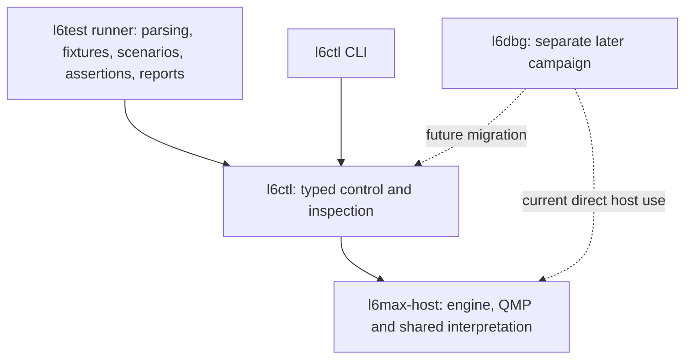
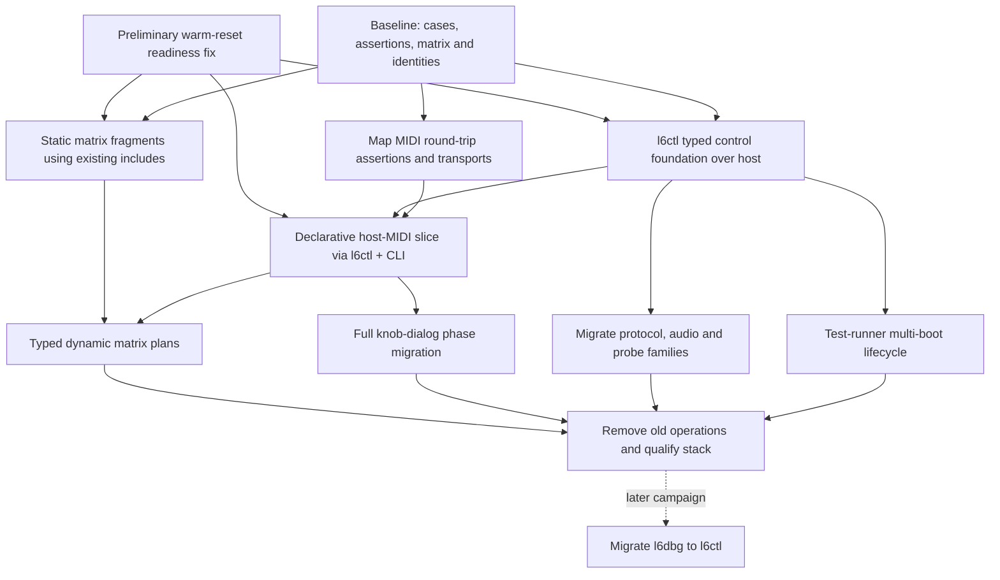

# Declarative Test Runner and Control Design

Status: the declarative test migration is complete on `main` at `5aa790371f84ded6b9b98d3f2813e22723751049`. This document combines the agreed design with a historical audit; its original inventory and sequence are not a current completion checklist. `l6max-host` owns guest access and shared domain interpretation; `l6ctl` exposes typed control and inspection; `l6test` stays a runner rather than becoming a public library. Linux packaged-GUI limitations and the separate deferred `l6dbg` campaign are recorded below.

The as-built progress event protocol and watcher are documented separately in [`l6test-progress-design.md`](l6test-progress-design.md).

Iteration uses one local integration tip, with short-lived slices integrated promptly. Run targeted Rust and generated-file checks plus focused runtime cases for each slice; use representative four-worker samples at integration checkpoints. Reserve all-suite qualification for the final stack tip. Preserve failed runs and record retries and binary/fixture identities. Group related changes into reviewable PRs without rewriting or closing existing PR history implicitly.

The replacement stack was reduced from seven M14 PRs to five. #208, #209, #210, #216, #214 and the separate M2/M16 child #215 are squash-merged. #211 was auto-closed when its base branch was deleted; #216 replaced its work. #212 and #213 were closed after consolidation into #214. All 93 superseded legacy PRs (#115–#207) are closed. The unrelated bootloader PRs #64 and #71 remain open.

### Migration status at a glance

The detailed slice checklist is in [Migration slices: implementation and remaining work](#migration-slices-implementation-and-remaining-work). At merged head `5aa79037`, the work is grouped as follows:

| Status | Slices | What remains at this level |
| --- | --- | --- |
| Done | M0–M3, M4–M10, M11–M16 | Declared sequences, shared typed APIs, documentation and focused checks are in place. M15/M16 integration evidence and platform caveats are below. |
| Done | M14 delivery | #208–#210, #216, #214 and #215 are squash-merged; all 93 superseded PRs are closed. |
| Deferred campaign | `l6dbg` migration | Separate from completing this declarative test design. |

"Done" describes the slice implementation, focused evidence and merged delivery. M2's QMP/GDB ownership boundary and M16's typed input boundary landed in #215. The Capella stack report includes two packaged-app cases that need separate platform interpretation; its BLOCKED result is not a clean all-suite pass. See the detailed table for acceptance evidence and caveats per slice.

## Problem and goals

Make the *test's behavioral sequence* visible as declarative, independently reported steps, composed from reusable fragments and shared tool APIs. Preserve the checks we already have: a smaller operation is not an improvement if it weakens the test. Cover ordinary scenarios, lifecycle tests, and the generated patch matrix. Expose reusable operations to Rust callers and, where they are independently useful, through the corresponding CLI.

A typed USB transaction, synchronized measurement, image comparison, or safely scoped debugger operation can remain an atomic primitive. Tests declare the sequence and assertions around those primitives.

### Non-goals

- Do not eliminate Rust, add arbitrary shell execution, or turn TOML into a general-purpose programming language.
- Do not replace rendered-pixel or actual protocol/transport verification with internal-state assertions.
- Do not turn `l6test` into a public library as part of this work, or migrate `l6dbg` in this stack.
- Do not rewrite the existing QMP implementation or require in-process tests to communicate through a CLI or socket.
- Do not add speculative crate layers or compatibility mechanisms without a concrete dependency or contract need.

### Design invariants

- Scenario sequencing, test-specific expectations, fixture isolation, timeouts and result classification belong to the test runner; shared guest access and domain interpretation do not.
- Each migrated case retains its meaningful assertions, model/revision and backend scope, binary/fixture provenance, cleanup guarantees and reviewed UI references. Static fragment extraction additionally preserves expanded order, case IDs and deadlines.
- Guest-time activity durations, bounded negative observations, wall deadlines, input acknowledgements, concurrent capture, reset freshness and atomic debugger scopes are explicit; a migration must not serialize away the behavior being tested.
- The user-facing `l6ctl` CLI and test runner call shared typed operations rather than independently implementing guest interpretation. Direct owned-guest and socket-attached capabilities remain explicitly distinct until supported and tested.
- Failures identify the specific assertion and observed/expected evidence. The progress stream records step start time and failure detail; the watcher derives the active step's wall duration until the next step starts or the scenario ends. It does not emit a separate successful step-completion event because the agreed watcher only needs the active step, while final case outcomes remain owned by the driver/report. Add completion events only if a consumer needs historical per-step completion data.
- Old monoliths and obsolete paths are removed once their behavior has demonstrable replacement coverage.

## What exists today

- `l6test` discovers case TOML and fragments, constructs isolated fixtures, stages and supervises processes, selects suites and matrix cases, and records progress, identities, outcomes and timings. It is currently a binary crate; the chosen plan keeps it a test runner, not a public library.
- `smoke-core` owns the shared scenario parser, runner and device operations used by the headless and GUI adapters. One scenario step produces one step-start event even when its Rust implementation performs many actions and checks. The versioned progress protocol records active-step start times and failure detail; the watcher uses the next step or scenario finish to stop the active duration. M16 moved runtime input observations and commands behind typed `l6ctl` APIs; remaining `InputHub` references in `smoke-core` construct unit-test fixtures.
- `include` expands an existing concrete TOML fragment, with model-scope intersection and cycle/depth checks. It has **no parameters, loops, arbitrary expressions, cross-step captures or resource scopes**. These are possible future designs, not current capabilities. Existing scenario guidance explicitly rules out general-purpose loops and expressions.
- The direct static-TOML inventory contains 85 distinct action names and 1,552 step declarations, including existing fragments. These are source declarations, not expanded cases; generated matrix steps and repeated includes are not counted. `devices::Operation` has 59 variants. Not all are monolithic, and some multi-action code lives outside that enum.
- An earlier all-catalog checkpoint exercised 372 case/model/backend combinations: 369 passed and three first-run failures passed focused retries with matching fixture and QEMU identities. Those counts are historical, not the current final-stack result. M14 later added fresh boot readiness after warm reset; the final-stack qualification is recorded under M15/M16 below.

## Shared tooling and candidate ownership

| Capability | Existing implementation and CLI | Proposed audit / boundary |
| --- | --- | --- |
| Firmware package | `l6fw` APIs and `l6fw unpack/repack`; `l6test` already calls `l6fw::unpack` | Reuse directly. `smoke-core` hard-codes update byte-sum logic; consider one typed, length-checked `l6fw` checksum/verification API and useful inspect/verify CLI. Keep corrupt-input construction and test expectations in scenarios. |
| NOR / settings / RTC | `l6nor::{Device, MainNor, Settings, PanelRtc}` and `info/dump/get/set/diff/seed/apply/rtc`; fixture setup already calls `state::apply` | Replace the hand-parsed settings/bank/version/RTC checks where the typed APIs provide equivalent semantics. Keep live trace assertions separate; an offline NOR file is not a live QMP read. |
| Patch construction | `l6patch::build(BuildRequest)` and `firmware/module/catalog/prebuilt`; fixture building already calls the API | Reuse directly; do not shell out to the CLI or duplicate composition. Keep matrix checks declarative and retain native/browser parity. |
| Card and USB storage | `sd_image::{CardSpec, Volume, entry_exists, read_file}`; `l6fs card ...` and `l6fs usb list/get/put`; shared host `MassStorage`/`UsbDisk` | Reuse typed card and transport APIs, but preserve the distinction between checking an offline image and actually exercising firmware's USB path. |
| Debugging | `l6max-diagnostics::gdb::Gdb`, `l6dbg` recipes and shared host QMP/input APIs | Extract common transport/session/inspection primitives where semantics really match. `l6dbg` currently starts a disposable guest and has an observational recipe model; a test scenario adds assertions, fixture isolation and report semantics. |
| MIDI / Editor | `l6max-host` has USB-MIDI codecs and production bridge; test-only host-MIDI client and Editor protocol assembly live in `smoke-core` | Consider a reusable transport client and model/revision-scoped Editor codec/session, with useful CLI send/receive/inspect operations. The production MIDI bridge is not already a test client. Keep expectations and test-specific sequencing out of the transport crate. |
| Audio | WAV parsing exists independently in `smoke-core::waveform` and host `audio_input` | Audit a shared decoder and audio-analysis API/CLI. First preserve differences in supported formats, channel/rate policy and precision with tests; do not silently substitute one parser for the other. Keep thresholds and observation duration in tests. |

## Architecture and ownership

### Today

- `l6test` is binary-only. It owns catalog/selection, fixture building, scheduler, subprocess supervision, retries, identity and reports. `smoke-core` is already a Rust library that owns the per-guest scenario model, runner and session. Exposing the current CLI `execute()` would leak argument parsing, rendering, process-global logging/signals and exits into library callers.
- Both `l6dbg` and `smoke-core` already use the **same** `l6max_host::qmp::QmpClient`; `emulator/host/src/qmp.rs` is the single raw `qapi` integration. It serializes access and bounds command execution. The engine owns private inherited QMP connections to MAIN and panel; these are not the optional external control socket.
- `l6ctl` is currently a binary with a private JSON client. It attaches to an emulator explicitly started with `--control-socket`. Its current surface is basic info, input commands and guarded FreeRTOS inspection; it does not expose general QMP, display frames, USB, GDB, reset, SD media or MIDI. Its input request returns after enqueueing; the scenario runner additionally waits for acknowledgements and/or observable output. The socket has deliberately bounded, user-only access and limits.
- `l6dbg` starts a new disposable headless guest, runs observation recipes and specialized probes, and emits diagnostic evidence. Its recipe interpreter and test scenarios overlap in operations but differ in semantics: e.g. diagnostic `wait guest_ms` is a duration, test `wait until` is readiness. Diagnostic raw reads/writes and calls have explicit firmware-hash, address, size and GDB guards; test assertions have model/revision scopes, per-step guest and wall deadlines, GUI/headless behavior and PASS/FAIL/BLOCKED semantics. Large `l6dbg` subcommands also bypass its recipe interpreter; they need their own inventory rather than being assumed to be recipes.

### Agreed target

`l6max-host` owns guest processes, QMP access and **shared firmware/domain interpretation**, returning typed observations with model/revision guards and accuracy metadata. `l6ctl` provides the higher-level typed control and inspection interface and CLI over those host capabilities; it can compose observations into reusable operations such as waiting for a task, but does not independently redefine firmware data. GUI and host-owned socket output consume the same interpretation. `l6test` owns test orchestration and pass/fail expectations. The existing dependency direction is `l6ctl -> l6max-host`.



`l6test` and its current internal test subsystem (`smoke-core`, which currently owns the shared parser/runner used by both backends) retain scenario parsing, orchestration, execution, assertions, scheduling and reporting. They use `l6ctl` for typed control rather than implementing shared operations directly; `l6ctl` builds on guest access and shared interpretation in `l6max-host`. This is a boundary for the **runner subsystem**, not a requirement to move the existing `smoke-core` files into a different package before starting. There is no `l6test` library project in this plan. Test assertions and scenario semantics do not move into `l6ctl`.

`l6ctl` provides a typed in-process API for test-owned guests and a separate, explicitly capability-limited client for the optional live control socket. The runner child (`smoke-core::Session`) owns the host `Engine`, `PanelFeed` and session lifecycle; the `l6ctl` adapter borrows those existing resources and does not start a second guest or create a competing panel-feed consumer. The `l6test` parent owns per-case process supervision. A MIDI session may own its endpoint subscription while the runner pumps the same guest session and owns test deadlines. `l6ctl` does not depend on `smoke-core`. Its CLI delegates to the same typed operations where the transport supports them. No CLI subprocess or socket hop is required to control an owned guest. Input socket commands acknowledge enqueueing, while scenario operations separately observe acknowledgement/output. MAIN/panel QMP, USB packet queues and retained GDB/QMP scopes remain in-process capabilities rather than control-socket features.

Do **not** make `l6max-host` depend on `l6ctl` while `l6ctl` depends on `l6max-host`: that creates a Cargo cycle. Host-internal engine/control-server code can continue to implement QMP and wire transport; `l6ctl` is the higher-level public operation layer used by the test runner. Where dependency direction prevents shared data types, consider a dependency-neutral `l6max-host-types` crate containing only types. A types crate alone does not solve a cycle in shared interpretation or dispatch: evaluate moving the dispatch owner, or a small transport-independent domain decoder in the appropriate crate, when a real consumer demonstrates the need. Do not introduce a speculative crate or duplicate the interpretation. Reuse the existing `QmpClient` rather than duplicating or rewriting it. Migrate test direct calls by operation family, with an inventory/guardrail against new direct low-level calls. Preserve MAIN vs panel, QMP deadlines and connection retirement after I/O error, process ownership, input acknowledgements, guest time, cleanup and debugger/revision guards.

Each reusable operation exposed through `l6ctl` or moved into another owning crate should have a corresponding useful CLI command as part of the same slice. CLI feasibility and ownership are acceptance criteria before extracting an operation: the current CLI only attaches through the optional socket, so direct-only USB/GDB operations need an explicit supported transport or session design. For operations that need a persistent session or atomic scope, design a CLI session/transaction that actually preserves those semantics; do not present unsupported or incomplete behavior as parity. Select an already supported capability for the first slice. Do not move test-only expected values, scenario control flow, fixture orchestration or PASS/FAIL policy into the control API.

`l6dbg` remains a **separate later campaign**, not a dependency or implementation target for this stack. Design `l6ctl` capabilities with its eventual migration in mind, including its raw diagnostic and GDB guardrails. Its own recipe model and specialized probes remain unchanged for now; when that campaign starts, inventory and migrate common operations to the same `l6ctl` API without assuming diagnostic and test recipes have identical semantics.

### RTOS example: current implementation and proposed boundaries

Today `l6max_host::qmp::QmpClient` reads bounded guest memory; `l6max_host::freertos` combines those reads with firmware/model revision guards, FreeRTOS structure decoding, consistency checks, derived task states, stack estimates and inferred heap ownership. The GUI calls those typed host functions directly. Separately, the host-owned control socket's `rtos_sample` transforms the results into schema-1 JSON, including fragmentation and task-state labels, and `l6ctl rtos` sends that socket request and prints the response. Thus interpretation is already spread across the host decoder, socket presentation and GUI; `l6ctl` does not currently own it.

The agreed target keeps the **shared firmware-aware decoder and interpretation in `l6max-host`** initially: host code performs the guarded memory reads and returns the same typed heap/task/scheduler/object observations to the GUI and host-owned control server. `l6ctl` exposes convenient typed operations and the CLI over those snapshots; it can add higher-level orchestration but must not duplicate what task states or heap blocks mean. Move common derived values such as fragmentation or canonical task-state representations into the shared host interpretation when both consumers need them; formatting remains at the presentation boundary.

Separate raw reading from firmware-aware decoding within the host as the code is touched, but do not force a crate split now. Moving that shared interpretation wholesale into `l6ctl` would create `l6max-host -> l6ctl -> l6max-host`, because the socket server lives in the host. If a real future consumer needs the decoder without the host, consider extracting a small domain crate; a `l6max-host-types` crate can share types if needed but cannot by itself share decoder implementation or resolve a dispatch cycle.

Keep existing schema-1 socket behavior and GUI results equivalent while ownership changes. Preserve model/revision guards, the fact that samples are non-atomic, guest timestamps, estimated stack headroom, inferred ownership and incomplete object coverage. Treat this as an audit/example for a later RTOS slice, not a prerequisite to implementing the initial MIDI case.

### Rough `l6ctl` command and Rust API map

These names are **proposals**, not existing syntax or a commitment to expose every QMP command. Each row describes one typed operation family consumed directly by the `l6test`/`smoke-core` runner and represented by a corresponding CLI command. The CLI calls the library; the test runner never shells out to the CLI. Test assertions, fixture selection, orchestration, timeouts and PASS/FAIL reporting remain in the runner. Expose model/revision-scoped symbols and typed results where possible; raw diagnostic access remains explicitly guarded. An API may also offer bounded streaming or resource guards that a one-shot command represents through a session/transaction, rather than pretending they are equivalent to independent invocations.

| CLI family (illustrative) | Rust control operations and test use | Status / design constraint |
| --- | --- | --- |
| `l6ctl info`; `l6ctl rtos heap\|tasks\|scheduler\|objects\|all` | `info()` and typed RTOS snapshots for model, live panel/guest status, heap, tasks and scheduler. Tests can capture observations and assert selected fields separately. | **Already available through the CLI socket.** Preserve guarded firmware/model support and explicitly non-atomic live snapshots; return typed structures rather than leaking CLI JSON into the runner. |
| `l6ctl button`, `down`, `up`, `encoder`, `analog`, `set-analog` | Typed button/encoder/analog input and sequence IDs; the runner uses acknowledgements and observable output as separate conditions. | **Already available through the CLI socket.** Today socket replies confirm enqueue, not guest application. Preserve that distinction; propose explicit acknowledgement/wait operations instead of changing the meaning silently. |
| `l6ctl status [--cpu main\|panel]`; `l6ctl pause`, `resume`, `reset` | Inspect run state and QMP events; stop/resume/reset the selected guest and observe completion or a fresh boot generation. | **Proposed CLI/API.** Host QMP already implements status, stop, resume, reset and event polling; the current control socket does not expose them. Model CPU selection and reset freshness explicitly. Do not equate a reset acknowledgement with mixer readiness. |
| `l6ctl memory read SYMBOL\|ADDRESS --length N`; `l6ctl registers`; `l6ctl jit` | Bounded memory, CPU register and JIT observations. A test can capture typed values and separately compare them, including snapshots across phases. | **Proposed CLI/API.** Host QMP already offers bounded reads and register/JIT queries; socket exposure is new. Apply model/revision/firmware guards to symbolic observations and label raw diagnostic access clearly. A QMP read is not a debugger write. |
| `l6ctl panel snapshot`; `l6ctl display snapshot`; `l6ctl input status` | Typed indicator/level, input-acknowledgement, guest-clock and retained-frame observations for checkpoints, readiness and pixel assertions. | **Proposed CLI/API.** Host `PanelFeed`/`InputHub` already provide pieces in process; the current socket does not expose the full surface. Preserve frame ownership, generation and static-screen semantics; keep reviewed-image comparisons and expected pixels in the runner. |
| `l6ctl sd status\|insert\|eject`; `l6ctl usb descriptors\|transfer` | SD media control and typed USB enumeration/transaction observations, allowing tests to express insert, wait, transfer and check separately. | **Proposed CLI/API.** Host has SD QMP methods and USB transport; remote access and status semantics need design. Preserve actual guest USB-path coverage, transfer/session ownership and bounded device waits. Offline image operations remain in `l6fs`/`sd-image`. |
| `l6ctl midi send\|receive`; `l6ctl editor request` | Typed MIDI/USB-MIDI messages and model-scoped Editor transactions, including reply observation, fragmented SysEx and keepalive sessions. | **Proposed.** Host has USB-MIDI codecs; test-private MIDI clients and Editor sessions need extraction. The production bridge is not already an equivalent client. Decide whether a command targets a live emulator, an OS MIDI port, or a session, and preserve their distinct semantics. |
| `l6ctl audio input load\|transport\|status`; `l6ctl audio capture` | Input transport and bounded sample/level capture used by tests that start an activity, observe for a declared guest duration, then analyze/assert. | **Proposed.** Choose the owning audio API and verify direct/socket availability before promising commands. Preserve concurrent capture and sample timing. Reusable WAV/tone analysis may belong in an audio tool; test thresholds and durations stay in scenarios. |
| `l6ctl debug snapshot\|breakpoint\|continue\|step`; `l6ctl debug transaction` | Scoped GDB breakpoint ownership, register/memory snapshots, synchronized stop/observe/resume and mutation/restore guards for firmware probes. | **Proposed; GDB-backed, not currently exposed by `l6ctl`.** Require an explicit session/transaction for resources that must survive multiple actions and guarantee cleanup. Preserve firmware hash, model/revision, address/range and mutation guards; QMP-only attach cannot be treated as full debugger support. |

The CLI should provide machine-readable structured results and actionable errors; human-readable formatting can be layered on top. Exact command spelling, argument types, capabilities, output schemas, and whether a CLI session is persistent are design decisions to validate with the first real consumer. Keep the existing attach behavior and socket security/limits; do not claim feature parity between direct-owned and socket-attached sessions until implemented and tested.

**Current implementation update:** this command map is a historical proposal, not an inventory of current syntax. The live CLI includes typed RTOS, USB, audio-input/audio-analysis, native-MIDI and scoped debugger commands; in-process `l6ctl` APIs also cover device operations used by the migrated scenarios. See [the `l6ctl` command reference](docs/development/tools/l6ctl.md) for actual commands and the direct-owned/socket capability boundary. In particular, the native MIDI CLI does not make USB packet queues available through the control socket.

For example, a proposed `l6ctl memory read SYMBOL --length N` command would call a typed library method such as `control.read_memory(cpu, location, length)`; the scenario runner would call that same method and perform its own expected-value assertion. Likewise, a future `l6ctl input wait-ack SEQUENCE` would correspond to a bounded typed acknowledgement wait, distinct from the existing enqueue-only input command. The method names and signatures here illustrate the relationship, not an implemented API.

At design time, the candidate foundation was to expose typed control/input acknowledgement semantics, then add MIDI and scoped debugger capabilities for the first slices. That sequence is retained as rationale only; implementation status and evidence are in the M2–M16 checklist.

## Original migration and implementation sequence (historical)

This was the agreed sequence before implementation. Its outstanding items are tracked by the current migration checklist above; do not read these numbered steps as the present status.

1. **Preliminary warm-reset fix.** On a separate PR from current `main`, make reset completion and subsequent readiness observe a genuine new boot generation. Establish a concrete QEMU/firmware/panel signal before choosing the barrier; QMP command acknowledgement alone is insufficient, and the separate panel clock must not be assumed to reset with MAIN. Add a meaningful regression check for stale pre-reset panel data and focused L6/L6max runs.
2. **Baseline and invariants.** Inventory each operation's test consumers, current assertions, generated IDs/expanded steps, fixture and binary identities, requirements, screenshots, and timing/cleanup semantics. Record the reset and dialog failure evidence. For static fragment moves, compare expanded typed scenarios exactly. For monolith decomposition, where step counts and labels necessarily change, maintain an explicit old-to-new assertion and step mapping, including `expected_failure.step`, its matched error substring, and progress/report identities. Add focused fault-injection tests for named failure reporting and cleanup.
3. **`l6ctl` typed foundation.** Add a library alongside the current CLI, wrapping the host's guest access and shared domain interpretation with typed inputs/results/errors. Preserve the separate direct-owned and live-socket modes and their actual capabilities. Migrate the existing CLI to use the typed API without changing behavior. Do not build a generic protocol or public `l6test` library.
4. **First end-to-end declarative slice: MIDI round trip.** Decompose one existing MIDI round-trip workflow into typed `l6ctl` MIDI session/send/receive and input/observation operations with corresponding useful CLI support; the test runner declares stimulus, observation and assertions. Preserve endpoint setup before input, per-model CC (`0x53` on L6, `0x51` on L6max), alternating encoder direction on repeated use, guest-time settling before the ring baseline, the outgoing CC value, expected ring change or deliberate absence, bounded waits and session cleanup. Start with the existing `host-midi` case on both models, using its native host endpoint, and retain the separate direct USB cable path and its distinct coverage. A native CLI may address an explicitly named OS MIDI endpoint, but must not imply that the current control socket exposes USB. Record how the CLI obtains a session or subscribes before receiving; preserve CoreMIDI/ALSA semantics and endpoint namespacing. Preserve bridge/USB requirements currently inferred from action names, parallel endpoint namespacing, identity, progress and failure evidence. Revision-bound observations must retain existing preflight/backend/image guards.
5. **Static patch-matrix fragments.** Move shared startup/check sequences into existing or exact-body new model-scoped fragments. Compare expanded typed scenarios, stable case IDs, fixture inputs, suite membership and coverage sets before and after. Retain typed combinatorial selection. Add only narrowly justified typed parameterization when a real case needs it; avoid a general scripting DSL.
6. **Decompose knob dialog by phase.** Add only the `l6ctl` snapshot, GDB/breakpoint, synchronized observation, mutation/restore and cleanup operations actually needed, each with a meaningful CLI surface. Move guard checks, callback race and lock contention, mode rendering/pixels, notification and expiry, navigation and heap invariants into declarative sequences or named cases. Preserve shared-session dependencies and exact race windows.
7. **Migrate remaining operation families.** Move reusable control and protocol operations to `l6ctl` or the owning domain crate, and corresponding independently useful commands to its CLI. Decompose Editor, MIDI/USB, effects, audio, panel, settings and registry assertions in individually reviewable slices. Preserve sample-accurate concurrent measurement, negative observation windows, guest vs wall time, model/revision scopes and cleanup.
8. **Lifecycle and matrix delivery.** Add test-runner-managed multi-boot scenarios with explicit firmware/state/card identities, transitions, artifacts and cleanup. Decompose firmware-update and native/WASM parity without moving test orchestration into `l6ctl`; preserve both models, rejection checks and reviewed pixels. Migrate dynamic matrix behaviors using typed plan data and the smallest concrete parameter support. Keep stable IDs, coverage sets and delivery semantics.
9. **Remove superseded actions and qualify.** Delete unused monoliths/dispatch/requirements once equivalence is demonstrated; regenerate schemas and snapshots, and update public and agent docs and CLI references. Preserve useful non-test behavior through owning APIs and CLI commands. The `l6dbg` campaign follows separately.

The runner resets its input baseline/last command on dispatch; preserve that behavior across step decomposition. The L6 input sweep now derives rejection allowances from the successfully completed typed action rather than a JSON evidence field (`21db94d0`); it still records the observed counts as evidence. Verify the desired progress events and force a subcheck failure to prove its name, result and evidence are visible.

For each slice: Rust/schema/catalog checks; deterministic expansion and requirement tests; focused model/backend cases with representative four-worker samples where relevant; fault-inject named failures and resource cleanup; compare original and migrated assertions and identities; report timing flakes. Use reviewed pixels to validate GUI rendering. At the final stack tip run both-model `wasm-patch`, `sd-matrix`, and the full catalog/stack with the packaged app. Do not run the full suite on every edit.

### Historical baseline: host MIDI round trip

This section records the behavior mapped before decomposing the MIDI action. The slice is now implemented and tracked as M3/M5 in the current checklist; the old one-action TOML description below is not current syntax. Its detailed invariants remain useful when reviewing future changes.

The first consumer is `tests/emulator/cases/midi/host-midi.toml`, which currently declares one `host-midi-round-trip` after boot/setup. This section describes current behavior as the baseline, not final TOML syntax. The same Rust helper also services direct USB and some cases immediately follow it with `host-midi-sync`; migrating only this case must not strand or silently change those consumers.

| Phase | Current operation and evidence to preserve | Ownership after decomposition |
| --- | --- | --- |
| Connect | Resolve the model-specific, namespaced native endpoint and subscribe **before** encoder input. Retry a missing native endpoint for up to 10 wall seconds while pumping the guest; other connection failures include bridge status. | `l6ctl` typed native-MIDI session; CLI exposes actual endpoint/session operations. Runner declares when to connect and reports the result. |
| Stimulate / receive | Turn channel 1 by four steps, alternating direction on repeated uses to avoid saturation. Poll every 5 wall ms for status/controller `[0xb0, 0x53]` on L6 or `[0xb0, 0x51]` on L6max. The current assertion matches those two bytes and records the third; it does **not** assert an exact value. | Runner declares input and expected CC; `l6ctl` provides input, receive and typed observations. Do not silently strengthen or weaken the check. |
| Settle / capture | Allow the encoder's remaining reports to land for 1,000 guest ms, then capture the channel-1 ring baseline. Receive and settle share the operation's wall deadline: `min(wall_timeout_s, 30s)` after connection; receive also uses the declared guest timeout. | Runner declares the observation duration and checkpoint; control API exposes actual observations. Preserve the shared wall deadline rather than silently resetting a default per new step. |
| Send / verify | Send `[0xb0, model_cc, 100]`, then observe the ring. The existing evidence records all before/after indicator words, although the assertion compares only ring 0; retain that evidence. The expected-change case waits up to `min(wall_timeout_s, 3s)` wall time for a change. The helper's direct-USB callers may instead expect no change, which requires observing the entire `min(wall_timeout_s, 3s)` wall-time negative window. | Runner declares the stimulus and positive/negative assertion; `l6ctl` sends/receives and samples. Preserve the direct-USB variant separately and do not treat the positive path as its equivalent. |
| Keep / release | The client is retained after success in device state. Subsequent `host-midi-sync` may consume queued messages and uses that same session; restart and all failure/cancellation exits must release owned resources. | Define explicit session ownership and teardown across declarative steps, preserve queue behavior and endpoint namespacing, and test cancellation, restart and failures. |

The intended first scenario is the existing `host-midi` case on L6 and L6max. Today its boot/setup steps end in one `host-midi-round-trip` action. Its conceptual expansion is:

```text
wait for boot -> include model setup -> connect and subscribe to native MIDI
-> turn channel 1 -> observe model-specific CC -> settle for 1,000 guest ms
-> capture ring baseline -> send model-specific CC value 100 -> expect ring change
```

Each arrow represents separately attributable behavior in the report, subject to the shared deadline and session contract above. This is not valid TOML or a proposed final action vocabulary; the implementation must express the same two model-specific cases with the current fixture and backend requirements. The native `host-midi` case expects a ring change; unchanged-ring observation remains coverage in its existing direct-USB consumers. Exact action names and TOML syntax are not specified yet. Test-specific assertions and failure outcomes remain in the runner; the control API supplies the reusable session and observations. A CLI command that receives across invocations needs a real persistent session or a single bounded transaction; a one-shot attach that subscribes after the event is not equivalent. Current CLI parsing unconditionally requires `--socket`: native OS endpoint commands must deliberately route before that check if they do not use the emulator control socket. A CLI listener must expose a subscription-ready signal before external stimulus, then report observed messages or a distinct endpoint-unavailable, timeout or unsupported error. Its integration test opens/listens, waits for ready, stimulates, observes and cleans up; verify teardown, repeated session reuse, one-based CLI versus zero-based host encoder indices (distinct from MIDI channel semantics), and enqueue versus guest-application acknowledgements. Preserve existing socket schema and output behavior; RTOS migration is not a prerequisite for this slice.

**CLI acceptance example (illustrative syntax):** a caller starts `l6ctl midi listen --endpoint <name> --timeout <wall-duration> --json`, waits for an explicit `ready` indication emitted only after the native subscription succeeds, uses the separately attached `l6ctl` input command to turn the encoder, then receives the observed CC as structured output. The listener exits successfully after its declared observation, or reports a typed endpoint/timeout/unsupported error and a nonzero exit; interruption releases the subscription. The native endpoint operation must not require `--control-socket` merely to listen, while the separate input command needs the emulator's control socket. The exact options, ready channel and JSON envelope are implementation decisions. Do not hard-code a MIDI value assertion that the original test never made. Test the integration end to end, including subscription-before-stimulus and cleanup.

**Bridge and requirements:** current preparation inspects action names to enable the native USB MIDI bridge, direct USB tokens and mixed DIN paths. Migrate that capability declaration together with the first consumer, and exercise native, direct and mixed-DIN combinations so the new steps cannot accidentally disable or compete for an endpoint. Preserve the existing firmware/model/backend gates and the external MIDI namespace.

**Migration gate:** enumerate the exact old checks and map each to a named new assertion; compare the model, backend, fixture, QEMU and reference identities, plus failure classification, not merely the number of steps. Keep the old internal action only for consumers not yet migrated, and delete it after the last consumer moves; this is an incremental migration aid, not a permanent compatibility layer. Add focused fake-session/fault-injection checks for missing endpoint, wrong/missing CC, expired shared deadline, expected and unexpected ring changes, queue retention and cleanup. Run the real two-model `host-midi` case and focused direct/mixed consumers, then a representative four-worker sample. Verify what the watcher actually displays on an injected subcheck failure; decide whether a versioned step-completion event is needed rather than assuming it already exists.

### Original PR exit criteria (historical)

| PR | Complete when |
| --- | --- |
| Warm-reset correctness | A deterministic regression reproduces retained pre-reset indicators and proves they cannot satisfy readiness; both L6 and L6max reach readiness after a real reset. The test identifies a concrete MAIN reset/new-boot signal and a fresh observation, preserves bounded deadlines and shared QMP event ownership, and does not rely on an arbitrary sleep or on the panel clock resetting. Focused runs cover the original failure; results retain binary and fixture identities. |
| `l6ctl` foundation | The library wraps existing host-owned capabilities without owning another guest or depending on `smoke-core`; the current CLI delegates to it with unchanged socket protocol, output, numbering and enqueue semantics. Unit/CLI checks cover direct and socket capabilities actually advertised, connection failures and cleanup. No RTOS redesign is required. |
| Static matrix fragments | The extracted fragments reproduce exact expanded typed steps, per-model scopes, child deadlines, ordering, IDs, fixture inputs and full/pairwise/single membership; representative cases pass. This PR has no dependency on the new control API unless it touches the same files and is explicitly stacked. |
| First MIDI slice | The existing L6 and L6max headless `host-midi` cases use named declarative phases backed by the typed API and useful CLI; the old-to-new assertion map and deadline/session contract above are checked. Native bridge selection, the still-supported direct-USB and mixed-DIN consumers, queue reuse, fault reporting, cancellation and cleanup have focused coverage. A forced failed subcheck identifies its step and observed/expected evidence in the actual report/watcher. |

## Original PR dependencies and parallel work (historical)

These dependencies describe the proposed implementation order at design time. The present PR state and delivery work are tracked under M14 above.

The graph shows proposed **landing** dependencies. Independent branches can start before their base lands, then rebase before review and merge.



- **Parallel immediately:** warm-reset fix on a separate PR; baseline/audit; a static-fragment matrix branch; and `l6ctl` API design/implementation. The MIDI assertion and transport map can proceed read-only. Integrate/rebase the reset fix before collecting final baseline evidence. Assign one owner to shared scenario fragments to avoid conflicting edits.
- **Landing order:** the reset fix lands on `main`; the typed foundation and static matrix PR are independent and may land in either order after rebasing onto the current base. The first MIDI slice depends on the typed foundation and the reset baseline; rebase it over the matrix PR if both touch the same fragments. **After the typed foundation:** the first vertical slice and matrix work can proceed in separate worktrees. Protocol/audio/panel families can be prepared in parallel once their required typed operations are agreed; integrate changes in dependency order so each PR builds and tests on its own base. Matrix and MIDI branches can touch the same fragments, so pick a merge order and rebase the other before integration.
- **Later:** multi-boot and dynamic-matrix work build on proven control primitives; remove old actions only after their coverage moves. `l6dbg` migration does not block this stack.
- **Execution:** focused emulator suites run one at a time on this machine unless explicitly planned on separate hardware; preserve the four-worker default for representative parallel samples. Provide a watch command for every run. Agents can audit, edit isolated worktrees and run independent non-conflicting checks in parallel.

The current `knob-dialog-popup` operation checks the recorder window, display change, callback/magic state, channel value and displayed value, including a `-2` then `+4` fallback at endpoint values. A later popup migration must preserve those exact checks and fallback; expiry, restoration and reviewed PNGs are separate coverage decisions.

## Resolved design decisions and deferred campaign

The initial architecture decisions are now reflected in code and the current migration inventory:

- `l6test` remains a runner; parsing, sequencing, orchestration and result classification stay in `l6test`/`smoke-core`.
- `l6max-host` owns emulator transport and shared firmware-aware interpretation. `l6ctl` exposes typed direct-owned and supported socket operations without claiming that those transports have identical capabilities.
- The control socket is distinct from QMP and GDB. It does not own the live in-process USB packet queues or the knob workflow's retained QMP/GDB lease; the direct-owned knob lease and its typed operations are now acquired through `l6ctl::OwnedControl`.
- Scenario fragments expand concrete TOML; adaptive plans use bounded typed data. Neither is a general-purpose language with loops, arbitrary expressions or unbounded execution.
- Native MIDI, USB, audio and RTOS command surfaces have advanced beyond the original proposal. The actual CLI syntax is maintained in `docs/development/tools/l6ctl.md`.

M2 focused validation and the reduced M14 replacement stack are complete and merged. The separate `l6dbg` migration remains deferred by design.

## Appendix: audited workflow operations and patch matrix

### Workflow-shaped operations

Classification is based on multiple externally meaningful actions, phases or assertions inside a single scenario operation, not line count alone. The names below correspond to `devices::Operation`; TOML names use kebab case. Each row should be checked against its actual case consumers and generated matrix before migration.

| Area | Operations to decompose or redesign | Where and why |
| --- | --- | --- |
| Knob / popup | `KnobDialog`, `KnobDialogPopup` | `tools/smoke-core/src/devices/knob_dialog.rs`: `run_knob_dialog` is about 1,470 lines and hides preflight guards, breakpoints, heap checks, semaphore contention, callback races, eight modes, notifications, expiry, navigation, framebuffer checks and cleanup. Popup has a conditional endpoint fallback that cannot be replaced by one fixed encoder move without proving the starting state. |
| Firmware lifecycle / parity | `FirmwareUpdate`, `WasmPatch` | `devices/lifecycle.rs` starts complete build/boot/reboot/verification flows. `session.rs` special-cases them as standalone sessions; splitting them requires managed multi-phase lifecycle and artifacts, not just replacing one TOML action. |
| USB, host MIDI and Editor | `UsbStorage`, `UsbMidi`, `HostMidiRoundTrip`, `DirectUsbMidiRoundTrip`, `L6maxDinMixerControl`, `L6DinUsbForwarding`, `HostMidiSync`, `L6MidiSync`, `L6MidiRingPinSweep`, `L6MidiMuteIndicators`, `UsbSysex`, `EditorPadAssignments`, `EditorPadPlayback`, `L6maxUiPadVerify` | `devices/execute.rs`, `devices/midi.rs`, `devices/editor.rs`, `host_midi.rs`: sequences contain transport setup, messages, waits and several assertions. A single typed request/response may remain atomic; test cases should own the message sequence and expectations. Preserve Editor keepalive, fragmented SysEx, endpoint ownership, model scope, and negative-observation windows. |
| Audio and effects | `SoundPadPlayback`, `L6RecorderPlayback`, `L6maxRecorderPlayback`, `EffectParameterEdit` | `devices/audio.rs`, `devices/sd.rs`: presses, playback/recording windows, signal acquisition, transport/firmware observations and analysis are coupled. Declare durations and assertions separately while retaining sample-accurate, concurrently collected measurements. |
| Panel and firmware probes | `PanelEvent`, `L6MainGpioEvent`, `L6UsbStartup`, `L6DinEventDispatch`, `L6maxTapHandler`, `L6InputSweep`, `L6DinSweep`, `L6maxInputTiming`, `L6maxPanelKeyMap`, `L6maxChannelSignalPwm`, `L6LevelMeterPwm`, `PowerPress` | `devices/panel.rs`, `devices/midi.rs`, `devices/usb.rs`, `devices/execute.rs`: control sequences and looped assertions are mixed with breakpoint management and simultaneous stimulation/observation. `PowerPress` also tests input acknowledgements, cutoff bounds, QMP shutdown and frozen panel-clock observation; split these into named phases around atomic capture. Represent the test sequence, while keeping an explicitly bounded simultaneous capture or critical debugger transaction intact where required. |
| Runner-native behavior | `SaveScene`; review `PressDisplayChange` and `SelectMode` | Original audit: these sit outside `devices::Operation`. Scene save is now composed from `momentary-down`, `expect-scene`, and `momentary-up`; preserve acknowledged press/release, exact trace counts, the selected scene lamp and cleanup. Keep reviewing display-change and mode-selection boundaries against their acknowledgements. |

### Audit snapshot and current migration status

The audit below records the original boundaries and their invariants; it is not a list of work still to do. On `integration/warm-reset-on-declarative-stack` at `09202075`, the standalone L6 USB startup and level-meter probes, scene save, persistence, knob first activation, and menu observation have been split into visible phases. USB setup now uses the shared `usb-enumerate.toml` fragment for controller readiness followed by enumeration. It preserves descriptor artifacts and the MIDI session; a four-worker focused run passed six USB, Editor, factory-protocol and DIN cases across both models. The socket CLI enumeration path has unit and wire coverage, but has not yet been verified against a live emulator.

Subsequent checkpoints moved L6 sound-pad readiness, SD loader readiness, effect-mode readiness, Editor MIDI and direct MIDI setup behind typed host/control interfaces. USB setup now shares the host controller reservation; Editor data exchange uses `l6ctl`, although callers sharing a raw reservation still coordinate their own operations. The two effect-parameter cases now capture the exact ring position, turn the physical encoder and assert the change as separate steps; their original display and effect checks remain. Generated matrix menu opening and dump-notification cleanup now compose ordinary fragments.

At this historical checkpoint, smoke-core still performed direct reads of engine-owned input snapshots and model metadata; later M2 work moved the retained knob QMP/GDB scope behind typed host/control APIs. M15 qualification of the M14 integrated tip is complete with its app-only blocks and SD timing flake recorded below. Preserve timing, concurrency, failure and cleanup contracts while continuing the source-boundary audit.

### Integration checkpoint: 21db94d0

The local integration branch has since split SD loading into loader, snapshot, allocation, chain, continuation, and module-byte phases, sharing a fragment where the expanded checks match. Effect slot type, processor, name, output, edit and dialog checks are separately reported. The MIDI negative-cable check now declares adjacent send and unchanged-ring steps, retaining its full wall-time observation. Editor assignment reports dialog handling and readback assertions separately; its SysEx codec and request encodings use shared host/control APIs. Audio input control and offline preparation, WAV validation, waveform comparison and tone measurements are exposed through `l6ctl`; test thresholds stay in the scenario runner. The L6 sweep rejection policy is typed by scenario action, not inferred from JSON evidence.

CI failure samples investigated on 2026-11-26: [#123 macOS](https://github.com/derekstavis/zoom-l6-hacks/actions/runs/45552144075/job/138995559910) failed the QMP interleaved-events test on `quit` with `Invalid argument`. At local integration tip `f11b2cf7`, that test passed 150 consecutive runs on this Mac; that does not prove the GitHub failure cannot recur. [#155 Linux](https://github.com/derekstavis/zoom-l6-hacks/actions/runs/45672767861/job/139412178569) and [macOS](https://github.com/derekstavis/zoom-l6-hacks/actions/runs/45672767861/job/139412179029) failed a stale browser-template fingerprint; `cargo l6patch prebuilt --check` passes on the local integration tip. A complete review of the failed jobs in the 27 unstable PRs at that snapshot found: 16 PRs with formatting failures on both platforms (#139, #144, #145, #147, #150, #152, #158, #160, #162, #163, #164, #166, #168, #172, #174 and #181); eight with stale-template failures (#153, #154, #155, #157, #159, #161, #165 and #167); #123 with the QMP test failure; and #137 and #186 with cancelled checks only. Some PRs also have cancelled older jobs. The local integration tip passes all three CI formatting commands as well as the prebuilt fingerprint check. Formatting failures stop the affected jobs before subsequent tests, so those logs do not establish that their other checks would pass. None of these local checks repairs the existing PRs' check statuses.

These are local checkpoints, not final qualification. Focused runs and their exact identities live under `l6-test-artifacts`; the latest L6 sweep passed at `l6-sweep-rejection-policy-v1`. Remaining work includes the retained knob debugger ownership boundary, a fresh audit of still-combined operations and dynamic matrix construction, stack consolidation, CLI/transport coverage gaps, and the full qualification gates. Live socket audio-input control was checked on L6; that does not establish live socket parity for every model or command.

### Current integration checklist (ccee2b8c)

This checklist supersedes the historical audit as a guide to the next work. The integration branch is local; the evidence below does not qualify any individual GitHub PR for merge.

- [x] Reconcile the warm-reset and matrix-fragment branches with the declarative stack locally. The current integration tip contains their changes; focused runs cover the integrated paths.
- [x] Expand the original major workflows into scenario phases, including lifecycle, MIDI, SD inspection, effect snapshots, audio, panel probes and power. The L6 MIDI hook's reply observation and terminal debugger finish are now separately reported.
- [x] Move the matrix's effect-slot assertion sequences to typed, bound fragments, and describe patch-specific menu checks in patch metadata. Comparison tests check expanded actions against the previous generator for all applicable combinations. Focused four-worker samples passed at `matrix-effect-fragments-v1` and `matrix-menu-metadata-v1`.
- [x] Route shared guest clock reads and power-input ownership through `l6ctl`; two-model power and mixed panel/MIDI/persistence samples passed at `power-held-control-v1` and `typed-panel-clocks-v1`. These samples do not establish all control APIs or transports.
- [x] Complete the M2 host-access audit: `smoke-core/src/devices` has no direct QMP/GDB client or `engine.management` access. The L6 MIDI probe, audio/panel/DIN scopes and knob probes acquire bounded host sessions or typed readers through `l6ctl::OwnedControl`; scenario-specific choreography and assertions stay in `smoke-core`. The knob scope has focused tests for restore ordering, revision/after-image failures, failed writes, synchronization, mailbox handoff and stop-before-cleanup, plus passing stock and SD runtime cases. `l6dbg` migration remains a separate campaign.
- [x] Attribute deferred assertion failures to their originating steps while continuing collection. Progress version 10 carries typed deferred failures; the watcher shows them live and after late attachment, and `scenario.json` retains every failure. The injected-failure run `deferred-assertion-injection-v2` produced the intentional eight failures, retained the full PWM artifact, and attributed the first failure to step 10 rather than the final step. This is focused evidence, not final qualification.
- [x] Audit M10's adaptive knob workflow: ordered typed children and bounded plan data are declared in TOML, each adaptive child and attempt is reported, and focused stock/SD runtime cases pass. M8's generated case identity and definition audit is complete, and M5's native-MIDI CLI versus in-process USB-MIDI boundary is documented and focused-tested. For any new operation, verify socket behavior only when the socket owns the corresponding transport; in-process coverage alone is not socket coverage.
- [x] Prepare a reviewable PR plan based on the integrated result. M14 began with seven sequential replacements and landed as #208–#210, #216, #214 and the M2/M16 child #215; all were squash-merged. All 93 superseded PRs #115–#207 were closed.
- [x] Run final qualification at the integrated tip: Rust checks, standalone cases, both models' browser patch checks, `sd-matrix`, patch matrices and the Linux `stack`. M15 records the SD timing flake; M16 records the final Capella run, packaged-app blocks and Linux GUI results.

### Migration slice completion status

This functional inventory records the implementation and its evidence; it is not a list of PRs or future tasks. **Done** means the behavioral sequence was decomposed and focused evidence passed. Transport limits and qualification caveats are stated per slice and in M15/M16 below. `l6dbg` is explicitly outside this campaign.

| ID | Slice | Status | Evidence and remaining work |
| --- | --- | --- | --- |
| M0 | Step model, progress and failure attribution | Done | Scenario phases and deferred assertion events identify the originating step; the injected PWM failure run retained and reported all eight failed channels. |
| M1 | Warm reset and fresh readiness | Done | The reset branch and QMP event barrier are integrated; focused two-model runs and M15 qualification passed. |
| M2 | `l6ctl` typed guest operations and QMP/GDB ownership | Done | The retained knob probe session and mutation journal are host-owned and acquired through `OwnedControl`. Memory, lifecycle/status, overlay, scheduler-tick and notification operations use typed control methods; no `engine.management`, QMP client or GDB client references remain under `smoke-core/src/devices`. Host adapter tests cover cleanup success and fail-closed revision, after-image and write errors; four journal tests and ten scenario cleanup tests pass. Capella focused runtime passed stock and SD knob-dialog (2/2, zero retries). Current integrated Capella qualification is recorded in M16. PR #215 is squash-merged with all CI jobs passing. Other debugger scopes use host-owned sessions or observers; `l6dbg` remains a separate campaign. |
| M3 | Native MIDI round trip and sync | Done | Declarative sends, observations, quiet/negative windows, cleanup and native CLI are present. Focused L6/L6max runs and final cross-platform qualification passed. |
| M4 | USB storage and descriptor transactions | Done | Storage transaction phases, readback, file assertions and enumeration are individually named; transaction/session ownership stays scoped. Final full-stack qualification is recorded under M15. |
| M5 | USB MIDI, SysEx and Editor | Done | `l6max-host` owns USB MIDI/SysEx transport and codecs plus Editor request/reply interpretation; `l6ctl` exposes typed in-process operations and the native MIDI CLI, while `l6test` declares Editor sequencing and assertions. The transport boundary is explicit: the control socket can manage USB controller ownership/enumeration, but live USB packet queues remain in-process and are not exposed by the CLI. Focused four-worker `m5-midi-editor-boundary-v1` passed `editor-pad-assignments`, `host-midi` and `usb` on both models (6/6, zero retries; per-case identities are in `m5-midi-editor-boundary-v1/report.json`). Final cross-platform and full-suite qualification is recorded in M15. |
| M6 | Firmware updates and browser parity | Done | Managed multi-boot stock/patched update campaigns, rejection cases and parity phases are declared. Both models and browser templates passed M15 qualification; packaged GUI cases passed on macOS. |
| M7 | SD loading and effect replacement | Done | Loader readiness, allocation, chains, continuations, active-chain module images, and latest-allocation image are distinct steps; effect identity/processor/output/edit checks are separate and revision guarded. The six-case SD phase report (local artifact: `/Users/derekstavis/Workspace/l6-test-artifacts/sd-module-phases-v1/report.json`; not checked in) passed before a final evidence-shape correction; after that correction, parser/matrix/schema tests and both-model absent-state report (local artifact: `/Users/derekstavis/Workspace/l6-test-artifacts/sd-module-absent-v2/report.json`; not checked in) passed. The loaded multi-module and hook-chain paths were not rerun after that evidence-only correction. The first report records runner SHA-256 `535c6ab955e3c20a75ad0b79574d471c031c19b4c9ef2e5498dce82ae983dc00`; the follow-up records `b4e12fc8053158014b30cbc362c6f5dfea9caebf36c102abb28b193190fd5e33`; both record QEMU SHA-256 `99bea36968509cd7cb67b6190e5af81d6bf8be0fb3965a20a788607fc6c76cc7`. M15 records the full SD matrix and browser/native parity qualification; one SD transition timing flake remains unexplained. |
| M8 | Generated patch matrix | Done | At the `ccee2b8c` checkpoint, the baseline (`origin/main` at `197d4451`) and integration catalog each produced 210 patch cases with identical IDs, models, backends, suites and definition hashes (resolved steps/includes, image references, state/card specs, case fields and campaigns). The subsequent SD assertion split intentionally changes definitions for SD cases while retaining their identities and suite placement; the reviewed snapshot is updated and `case_matrix` passes. The new behavior also passed the six-case SD sample. Full runtime qualification is recorded under M15. |
| M9 | Persistence and scene save | Done | Persistence uses separate capture, version, RTC, bank, trace, panel and reload assertions around restart; the focused L6max persistence case passed in settings-declarative-v1 (local artifact: `/Users/derekstavis/Workspace/l6-test-artifacts/settings-declarative-v1/report.json`; not checked in). Scene save in `tests/emulator/fragments/l6-gui-controls.toml` uses visible `momentary-down` → `expect-scene` → `momentary-up` phases for each L6 scene. The runner retains command acknowledgements and exact press/release trace counts across those phases and releases held input during cleanup; the shared UI-input case passed on L6 headless and GUI in scene-momentary-v1 (local artifact: `/Users/derekstavis/Workspace/l6-test-artifacts/scene-momentary-v1/report.json`; not checked in). M15 records lifecycle/GUI qualification; preserve the original bank and raw RTC predicates in future edits. |
| M10 | Knob popup and dialog | Done | Dialog behavior is declared as phases for preflight, activation, adaptive attempts, bitmap, callback, notification, restoration and navigation. The adaptive probe's TOML declares ordered typed children, target values, bounded attempts/durations and artifacts. Its runner reports child/attempt start and finish with progress attribution. Focused L6max stock and SD knob-dialog cases passed in knob-adaptive-focused (local artifact: `/Users/derekstavis/Workspace/l6-test-artifacts/knob-adaptive-focused/report.json`; not checked in) (5/5 cases overall, including the two adaptive consumers); the report records runner SHA-256 `6168ae85799538e9a0ed3363dc3e26af808bd483f345b2c4f2f7fd20f276254e` and QEMU SHA-256 `b6e04cd4ae7fa9ab940d22aa9168ac2fc534ade65979eee08835d72bd504a167`. Keep semantic branching in the typed plan executor. M2 separately owns the host scope behind this already-declarative workflow; this transport concern does not make the workflow itself incomplete. |
| M11 | Audio callbacks, pad playback and recorders | Done | The callback and recorder scopes use `l6ctl::OwnedControl` to obtain host-owned debug sessions/readers. Their debugger choreography stays in `smoke-core` because breakpoint order, synchronized samples, trace windows and expected callback/recorder events are test-specific; decoded recorder and audio-trace structures stay in `l6max-host`, and waveform/tone thresholds stay in the runner. Sound-pad and Editor playback have separate press/play, wait, capture, analysis and assertion steps. Focused four-worker runs passed `audio-path` (both models), both recorder cases, both sound-pad waveform cases (6/6), plus L6 `l6-editor-pad-playback` (1/1), all with zero retries; per-case identities are in `m11-audio-phases-v1/report.json` and `m11-editor-playback-v1/report.json`. Full qualification is recorded under M15. |
| M12 | Panel, GPIO, timing, power and DIN probes | Done | Source audit confirms stimulus, input acknowledgement, captured report/snapshot, model-specific interpretation, assertion, release and settle phases are independently represented across panel-event, GPIO, dispatch, timing, TAP, power and DIN workflows. Atomic panel-key and timing captures are coherent observations; their expected values remain scenario assertions. Debugger sessions are bounded host-owned sessions obtained through `l6ctl::OwnedControl`, with no separate QMP transport in these probes. A focused four-worker sample passed power on both models plus `l6-din-sweep`, `l6max-din-mixer-control`, `l6-event-dispatch`, `l6-main-gpio-events`, `l6-panel-event-map`, `l6max-input-smoke` and `l6max-tap-handler` (9/9, zero retries; per-case identities are in `m12-panel-power-din-v1/report.json`). M15 records GUI/backend and remaining case qualification. |
| M13 | Documentation and agent guidance | Done | Reconciled the current ownership and workflow inventory with the design: `l6max-host` owns shared transport and domain interpretation, `l6ctl` exposes typed in-process and supported socket/CLI operations, and `l6test` owns sequencing and test assertions. `docs/development/tools/l6ctl.md` states the native-MIDI CLI versus in-process USB-MIDI boundary; `scenario-format.md` now lists the split `expect-sd-module-images` and `expect-sd-latest-module` actions, and the testing guide describes both checks. The repository `AGENTS.md` already directs authors to named declarative steps and typed host/control APIs. The stale action name is absent from development docs; `git diff --check` passes. |
| M14 | PR grouping and delivery | Done | #208–#210, #216, #214 and #215 are squash-merged. #211 was auto-closed with its deleted base branch and replaced by #216; #212 and #213 were closed after consolidation into #214. All 93 superseded legacy PRs (#115–#207) were closed after the replacement stack landed. |
| M15 | Final qualification | Done with platform limitations recorded | The integrated stack passed 314 cases on Capella Linux with 2 packaged-app cases blocked when no AppDir was supplied. A Linux AppDir follow-up exposed the L6 bundle's panel aspect-ratio failure and confirmed the menu smoke test is macOS-only. Earlier M14 integrated qualification passed the patch matrices and `sd-matrix` after an initial timing flake; packaged-app cases passed on macOS. Exact identities and reports are recorded below. |
| M16 | Typed scenario input boundary | Done | `l6ctl` exposes typed input snapshots, analog and panel-knob gestures, and MIDI bridge status. `smoke-core` scenario devices use `Session`/`OwnedControl` rather than reaching into `Engine`; `Session.engine` is private, and `Runner::tick` plus the GUI scenario adapter use `InputObserver`. GUI capture and GIF paths use the typed API. The interactive emulator GUI remains an `Engine` owner for its normal controls; M16 removes that access from test scenarios. Formatting, workspace check, targeted host/l6ctl tests, all 84 runner tests, and the release Rust workspace suite passed. The five-case Capella Linux sample passed (5/5); `ui-input-l6-gui` passed (1/1). The final integrated stack run and exact report identities are recorded below. PR #215 is squash-merged. |
| Later | Diagnostics and `l6dbg` | Deferred | GUI probe uses `l6ctl` for input and symbol reads. Full `l6dbg` migration is a separate campaign and is not a prerequisite here. |

**M14 check diagnosis (rechecked 2026-11-26).** The 27 declarative PRs marked `UNSTABLE` still group as follows: 16 fail Rust formatting on macOS and Linux (#139, #144, #145, #147, #150, #152, #158, #160, #162, #163, #164, #166, #168, #172, #174, #181); eight fail `l6patch`'s committed browser-template fingerprint because `tools/patch-wasm/templates/manifest.json` is stale (#153, #154, #155, #157, #159, #161, #165, #167); #123 fails `qmp::tests::typed_management_preserves_events_interleaved_with_replies` on macOS at `emulator/host/src/qmp.rs:277`, where a socket operation returned OS error 22 (`Invalid argument`) and the test unwrapped it; #137 and #186 have cancelled macOS jobs, but their Linux and AppImage jobs pass and the current check set has no failing conclusion for them. Current representative logs: [formatting failure on #139](https://github.com/derekstavis/zoom-l6-hacks/actions/runs/45719190137), [stale-template failure on #153](https://github.com/derekstavis/zoom-l6-hacks/actions/runs/45668017217), and [QMP test failure on #123](https://github.com/derekstavis/zoom-l6-hacks/actions/runs/45552144075). A cancelled job is not a passing check. The formatting and template groups need their respective deterministic fixes; #123 needs a code-level diagnosis; #137/#186 need a completed macOS check if they remain in the delivery stack.

**Source-equivalence review:** #115's three startup/mixer fragment files are byte-identical at the local integration tip. The integration has `expanded_matrix_preserves_model_specific_startup`; its historical 210-case catalog comparison also found matching IDs, models, backends, suites, fixtures and expanded definitions against the then-current `main`. #119's generator has since evolved substantially, so commit-level diff equivalence is not a useful test by itself; the current code has per-combination expanded-step comparisons for generated menu and effect checks, and the matrix snapshot was reviewed. #117's fresh post-reset readiness behavior is present in the integration and focused L6/L6max runs passed. This supports behavioral integration, but does not restore the original PR commit ancestry or substitute for rerunning the current checks before landing.

**M14 consolidation plan (initial plan, superseded 2026-11-26):** replace the 93 open PRs (#115–#207) with seven sequential review units cut from the integrated linear history, based on `main` at `197d4451`. The old numeric ranges are not valid stack boundaries: GitHub's base graph crosses those ranges (for example, #139 is based on #180; #170 is based on #182). The integration branch `ccee2b8c` was 187 commits ahead of `main`; 90 of the 93 open PR head commits are exact ancestors. The three remaining heads (#115, #117, #119) have later integration commits that replace their startup-fragment, warm-reset-readiness and typed-matrix-plan changes. The initial seven replacement PRs were #208–#214; the current five-unit structure is summarized after the historical table.

Each PR is based on the previous replacement and squash-merged only after its checks pass. These boundaries partition the 187-commit history in order and keep the existing dependency sequence intact:

| Replacement | Commit range | End commit | Review focus |
| --- | --- | --- | --- |
| [#208](https://github.com/derekstavis/zoom-l6-hacks/pull/208) Control and first scenario phases | 1–30 | `5e006c54` | Typed control, MIDI/persistence primitives, initial knob and MIDI scenario phases. |
| [#209](https://github.com/derekstavis/zoom-l6-hacks/pull/209) Update and MIDI probes | 31–45 | `2a6fe8f2` | Managed update workflows, debugger sessions and MIDI hooks. |
| [#210](https://github.com/derekstavis/zoom-l6-hacks/pull/210) Knob, SD, effects and indicators | 46–76 | `b8965377` | SD/effect assertions, knob probes, USB/DIN phases and indicator deadlines. |
| [#211](https://github.com/derekstavis/zoom-l6-hacks/pull/211) Playback and device campaigns | 77–96 | `dde53d82` | Sound-pad/Editor playback, timing, recorder/update campaigns, storage and power. |
| [#212](https://github.com/derekstavis/zoom-l6-hacks/pull/212) Shared runner and core scenario migrations | 97–116 | `a00c815f` | Warm-reset, patch-matrix plans, audio/DIN/GPIO, persistence, USB startup, meter and panel phases. |
| [#213](https://github.com/derekstavis/zoom-l6-hacks/pull/213) Typed ownership and detailed assertions | 117–149 | `2edeb5ea` | Host/control ownership, Editor/MIDI, effect and SD readiness/assertion decomposition. |
| [#214](https://github.com/derekstavis/zoom-l6-hacks/pull/214) Audio APIs, reporting and cleanup | 150–188 | `5b47aab1` | Shared protocol/audio helpers, failure evidence, resource cleanup, scenario guidance, final probes and M15 qualification fixes. |

Each original cut point passed Rust formatting, workspace check and catalog-list validation. #208–#210, #216, #214 and #215 are squash-merged. After reviewing the actual GitHub diff sizes, #212 and #213 were consolidated into #214: the combined tail was 178 files and 31,734 additions / 7,788 deletions from #216. Deleting #210's base branch auto-closed its child #211, so the rebased #211 work landed as #216. The five-unit M14 stack kept the knob/SD/effect, playback/device, and shared/control/qualification changes reviewable instead of producing one 100k-line review. The 93 superseded PRs were closed after the replacement stack landed.

#### M15 Linux and packaged-app trial (2026-11-26)

Capella PC has 32 CPU cores and runs Linux 7. The release `stack` run used eight workers and selected all 316 headless cases across both models. It completed in 884.9 seconds of case time with **314 PASS, 0 FAIL, 2 BLOCKED**. `gui-bundle` and `gui-menu` were blocked because they require a packaged app; both passed on macOS (87.4 seconds total). The isolated L6 DIN case passed on macOS (28.0 seconds), and the final Linux stack passed the DIN case under parallel load.

The first Linux full run exposed that patch compilation did not search `PATH` for `llvm-readelf`; the l6test child environment intentionally removes host `L6_*` variables. `patch-compile` now falls back to `PATH` after the explicit, Homebrew and Rust-toolchain locations. After regenerating the browser template manifests and case-matrix snapshot, focused `wasm-patch` passed on both L6 and L6max. The full workspace `cargo fmt --all --check`, `cargo check --offline --locked --workspace --all-targets`, and `cargo test --offline --locked --workspace` passed on Capella; both QEMU panel and MAIN-copy qtests passed there as well.

The first Capella `sd-matrix` run completed with 22 PASS and one FAIL: `sd-effect-editor-mode-restore` timed out at step 207 (`Select sub mix mode`). At the timeout, guest time advanced while the main-panel frame timestamp remained at 43.2 seconds; this does not by itself identify the cause. The case then passed both as an isolated one-worker run and in a fresh full `sd-matrix` run with eight workers (23/23 PASS). Record this as a timing flake across runs, not as a clean first pass; the intermittent transition stall remains unexplained. The current aggregate therefore has no reproducible Linux failure, but this flake should remain visible in qualification records.

Evidence is stored outside the repository under `m15-capela-linux-20261126` (local artifact: `/Users/derekstavis/Workspace/l6-test-artifacts/m15-capela-linux-20261126`; not checked in), including stack, initial and repeated SD-matrix, isolated-case, focused patch, and macOS reports with their manifests. The final full-run runner SHA-256 is `70103f14a75479e5b358199060cc9d41e8a7915ff96bdac3cc020914fb71a984`, and QEMU SHA-256 is `73f770d3129dbd50e8d352a0f6c33f4c8d242d96a5afabe3c3d2805a9fb3b7b4`; firmware-package and per-case identities are in the reports. The initial and repeated SD-matrix manifests match, including the runner and QEMU identities. The packaged GUI executable SHA-256 was `c7e51a5bf5a3e3a042dcc25a6cf70de94ed92e66b98cf5137e4fab4c53327c9e`; its bundled QEMU SHA-256 was `eb0bdfdee1bab504f11148fd445ed0c2be47cfb68546df69f6514f77ec3e4d42`.

Focused runtime identity for M5, M11 and M12: tooling commit `ccee2b8cde092240cf85a217d07b9e10832f4ab5`; runner SHA-256 `b4e12fc8053158014b30cbc362c6f5dfea9caebf36c102abb28b193190fd5e33`; QEMU SHA-256 `99bea36968509cd7cb67b6190e5af81d6bf8be0fb3965a20a788607fc6c76cc7` (external source unattested). L6 package / MAIN SHA-256: `64f1f36b8383176b5d841911fbf3c16205139a313ee88be906f313b1a98a33fb` / `61437ac9fb63a62d3b5ae6cd18218762d745e0ac5b438c6d02a34d299ee635f6`. L6max package / MAIN SHA-256: `4e20f92c9c5131ed082c0feec2b2d7d0445fb576296f11f6dace56a4fc0c9b47` / `83bacfb2b131329b99a3be72cc1a5c273777f9d37f5a818b3e6878c44ce47e8b`. The reports below contain every case's state and card hashes and outcome:

- M5 report (local artifact: `/Users/derekstavis/Workspace/l6-test-artifacts/m5-midi-editor-boundary-v1/report.json`; not checked in)
- M11 audio report (local artifact: `/Users/derekstavis/Workspace/l6-test-artifacts/m11-audio-phases-v1/report.json`; not checked in) and Editor playback report (local artifact: `/Users/derekstavis/Workspace/l6-test-artifacts/m11-editor-playback-v1/report.json`; not checked in)
- M12 report (local artifact: `/Users/derekstavis/Workspace/l6-test-artifacts/m12-panel-power-din-v1/report.json`; not checked in)

#### M2 host/control boundary audit

This source-level audit was first recorded at integration tip `ccee2b8c`; the M2 implementation progress below records the current source and runtime evidence:

| Use site | Current path | Disposition |
| --- | --- | --- |
| Panel, GPIO, TAP, meter, USB-startup, DIN dispatch/sweep, MIDI probe and audio recorder/callback observations | `l6ctl::OwnedControl` acquires the host's bounded debugger session/observer; `l6max-host` owns QMP/GDB and provides typed debugger commands, readers and snapshots. | No duplicate QMP transport or parser was found. Keep scenario expectations, model guards, deadlines and evidence in `smoke-core`. An in-process owned-guest session need not be forced through the optional socket. |
| Editor SysEx and direct USB-MIDI | Shared USB endpoints, transport reservations and MIDI/SysEx codecs are host/control types; Editor protocol sequencing is in the scenario device module. | Keep protocol exchanges and assertions declared in scenario phases. Socket-attached CLI parity is not established for an emulator-owned live USB session; do not imply that it is. |
| Knob-dialog preflight and probes | `KnobPopupProbeSession` is acquired through `l6ctl::OwnedControl`; bounded memory reads and guest lifecycle/status operations also use typed control methods. `l6max-host` owns the retained debug session and mutation journal. | Source boundary is complete in `smoke-core`; retain one bounded session, revision guards, before/after restoration checks, fail-closed behavior and cleanup ordering. Add focused integration evidence for failed preconditions and cleanup poisoning. |
| Knob overlay reader construction | `execute.rs` acquires the guarded overlay reader through `OwnedControl::knob_overlay_reader_before_checked`. | Complete; the host keeps QMP ownership and the caller retains cancellation/deadline checks. |

The M2 host boundary is complete at the source and focused-test level: host-owned debugger sessions centralize transport and typed guest operations, and the knob workflow's retained GDB/QMP scope is behind `l6ctl::OwnedControl`. A source audit found no QMP/GDB clients or direct `engine.management` access under `smoke-core/src/devices`. The M2 tree's Linux `full` run is recorded below. A multi-phase mutation session remains intentionally outside the control-socket CLI because that socket does not provide equivalent ownership or lifecycle semantics.

#### M2 source-grounded API boundary

The implementation composes the existing host transport owners: `l6max_host::debug::Session` acquires the in-process debugger lease and tracks breakpoint/register state, while `l6max_host::debug_journal::Journal` records restoration state without owning transport. `l6max_host::knob_popup::ProbeSession` now combines these with guarded QMP reads and owns cleanup. `l6ctl::OwnedControl::knob_popup_probe_before` returns that opaque scope; scenario code no longer constructs a QMP or GDB client.

The scope lives in the `l6max-host` knob-popup/debug domain, not a new crate or socket protocol. It composes the existing debug lease and journal with revision-checked knob-popup readers. It exposes typed capabilities needed by the probes: guarded observations; temporary writes to validated probe targets; owned breakpoint operations; bounded stop/resume/continue/register or call operations; mailbox handoff/acknowledgement; and one explicit finish/abort path. Keep raw QMP/GDB clients, engine fields, arbitrary address writes and transport handles private. `smoke-core` retains the ordered probes, patch-specific target selection, thresholds, expected values, deadlines, progress events and assertions.

The source-level call inventory supports that scope and separates ownership from scenario logic:

| Operation in `devices/knob_dialog.rs` | Behavior to preserve | Implementation status |
| --- | --- | --- |
| QMP `read_memory` / `read_memory_before`, `query_status`, `stop` / `stop_before` | Probe-specific snapshots and status checks, using the existing shared deadline and MAIN-time checks | Complete: `l6ctl::OwnedControl` routes these through bounded memory and guest lifecycle methods without exposing `QmpClient` to `smoke-core`. |
| GDB `write` / `write_before` paired with QMP before-images | Record possible partial writes before I/O; reject overlap; guard writes; validate target before restoration | Implemented in `ProbeSession` with the journal. Uncertain I/O poisons the scope and prevents resume. |
| GDB breakpoints, register reads, `continue_until_stop`, `call_thumb` | Keep ownership across phases, clear stale saved registers on resume, retain deadlines | Implemented as bounded host operations. The scenario chooses addresses, arguments, expected registers and stop conditions. |
| Mailbox handoff and acknowledgement | Transfer ownership only after guest acknowledgement | Implemented in the host scope; missing acknowledgement fails closed and leaves MAIN stopped. |
| `KnobDebugSession::finish` and `Drop` cleanup | Require a clean journal on success; on failure, stop MAIN, restore writes, clear breakpoints/registers, and resume only after all stages succeed | Implemented through explicit host `finish`/`abort`, using the cleanup journal; cleanup failures are retained with the scenario error. |
| `overlay_reader_before_checked(...)` in `execute.rs` | Retain the existing revision/model guard and cancellation/deadline checks while acquiring a reader for the overlay probes | Complete: `OwnedControl::knob_overlay_reader_before_checked` retains host QMP ownership and returns the typed reader. |

This inventory began as a source inspection at `ccee2b8c` and now records the implemented boundary. Moving types behind a wrapper alone would not suffice; preserve the listed ordering and safety invariants, with focused failure-path evidence recorded below.

The follow-up reuse audit established which existing host APIs could be composed:

| Capability | Existing reusable API | Implementation status |
| --- | --- | --- |
| Acquire the retained GDB lease; bounded register, breakpoint, continue and step commands; restore the session's own scratch/breakpoint state | `OwnedControl::debug_session_before` returns `l6max_host::debug::Session`; its `Command`/`Observation` API includes register, memory-read, breakpoint, continue and step operations, and it has explicit close-stopped/close-resuming methods. | Composed with guarded QMP reads and the knob mutation journal in `ProbeSession`. |
| Read knob-popup state and construct a revision-guarded overlay reader | `l6max_host::knob_popup::Reader`, `OverlayReader`, and `overlay_reader_before_checked` already provide typed reads and model verification. | Complete: `OwnedControl` acquires the typed reader and supplies its private QMP client while retaining the caller's cancellation/deadline checks. `smoke-core` does not pass `engine.management[0]`. |
| Record, restore and validate temporary writes; track mailbox transfer | `l6max_host::debug_journal::Journal` records writes, breakpoints/registers, synchronization and mailbox state; `cleanup` defines stop → restore writes → clear breakpoints → restore registers → resume ordering. | Implemented by the host scope, including target/revision guards and failure poisoning. The journal itself owns neither QMP nor GDB transport. |
| Obtain the scope through typed control | `l6ctl::OwnedControl` owns the in-process acquisition façade for debug sessions and observers. | Complete: `knob_popup_probe_before` returns the opaque host scope. No socket protocol or CLI operation is needed for this in-process-only lease. |

This audit led to composition and safe QMP/GDB mutation ownership without adding a second debugger transport or replacing the existing lease, readers, or cleanup journal. Implementation, adapter failure-path tests and normal-path runtime evidence are recorded below.

Retain one host scope across the current phases. Each mutation must be registered before transport I/O; restoration must revalidate the target and expected revision; a failed or uncertain operation must poison the scope and leave MAIN stopped. Cleanup follows the existing journal order and must not resume after a failed guard or partial restoration. Mailbox writes transfer ownership only after a guest acknowledgement. Socket/CLI support is out of scope because a socket-attached process does not own this in-process GDB/QMP lease.

#### M2 completion contract for the knob workflow

The retained debugger scope and mutation journal live in `l6max-host::knob_popup::ProbeSession`, acquired through `l6ctl::OwnedControl` with the scenario's existing wall deadline. The source-boundary criterion is met: `smoke-core` contains no raw GDB/QMP client or direct engine management access. `ProbeSession` cleanup delegates ordering and fail-closed gating to the same `debug_journal::cleanup` implementation covered by fake-backed tests, while its host adapter performs guarded writes and transport operations. Focused adapter tests cover restoration failures; passing stock and SD runtime cases cover the normal path.

`smoke-core` should continue to declare the probe order, adaptive decisions, fixture expectations and pass/fail assertions. Keep one retained session across the existing phases so guest snapshots, temporary mutations, deadline accounting and cleanup ordering remain intact. The control socket and `l6ctl` CLI do not need this mutation session: direct USB and other short-lived socket operations do not provide its exclusive QMP/GDB lifetime or restoration contract. Add socket/CLI support only if a separately owned remote session protocol is designed and required.

Acceptance evidence includes the source audit, focused tests for revision guards, normal restoration, failed writes, failed preconditions (leave MAIN stopped) and cleanup errors, plus stock and SD knob-dialog runtime cases. Runner, QEMU and firmware identities are recorded in the reports; the scenario retains child-level progress and assertions.

#### M2 implementation progress (2026-11-26)

The M2 implementation was rebased, extended with M16 and squash-merged in [PR #215](https://github.com/derekstavis/zoom-l6-hacks/pull/215) on 2026-11-26. Its final macOS, Linux and AppImage CI checks all pass. `l6max-host::knob_popup::ProbeSession` composes the host debug lease with bounded QMP reads, the mutation journal, guarded rollback, breakpoint/register cleanup and mailbox handoff. `l6ctl::OwnedControl::knob_popup_probe_before` is the acquisition point. The runner no longer constructs a `Gdb`, owns the retained journal, or accesses `engine.management`; its bounded memory, stop/resume/status, scheduler-tick, notification and overlay-reader operations use typed control methods. The journal records before and expected-after bytes; rollback rechecks the firmware revision and current target bytes before restoring.

Capella checks passed `cargo fmt --all --check`, workspace `cargo check --offline --locked --workspace --all-targets`, four `l6max-host::debug_journal` tests, and ten `smoke-core::devices::knob_dialog::debug_cleanup_tests` (fake-backed journal ordering and fail-closed policy). Final release runs passed `knob-dialog` and `sd-knob-dialog` on L6max headless (2/2, zero retries) after the complete source-boundary change. The earlier attempts exposed and corrected a too-narrow guarded-read range and a missing `rust-src` selection for the SD patch build; those setup/code failures are recorded in the v1 report and were not counted as clean passes.

The first checkpoint artifacts remain under `m2-knob-host-scope-v1` (local artifact: `/Users/derekstavis/Workspace/l6-test-artifacts/m2-knob-host-scope-v1`; not checked in). After routing all knob memory, status, stop/resume, overlay, tick and notification access through `l6ctl::OwnedControl` and consolidating cleanup policy, the latest focused run is stored under `m2-knob-host-scope-v4` (local artifact: `/Users/derekstavis/Workspace/l6-test-artifacts/m2-knob-host-scope-v4`; not checked in): `knob-dialog` and `sd-knob-dialog` passed on Capella Linux (2/2, no retries). It records driver SHA-256 `f4c6132605e1268a8ace919c760fa19cc72c19b153eb6d2f75d53ab8ae809d32`, QEMU SHA-256 `73f770d3129dbd50e8d352a0f6c33f4c8d242d96a5afabe3c3d2805a9fb3b7b4`, and tracked-diff SHA-256 `3e74a5296151e5fa831dccf70bd55710be30a1ae96b006017d91ade850467150`; exact firmware, state and card identities are in `report.json`. Workspace check passed. Four `ProbeSession` adapter tests now exercise success ordering, revision mismatch, changed after-image and failed restore writes; four journal tests and ten scenario cleanup tests also pass. M2 is complete at the focused implementation level; its Capella Linux `full` run is recorded next.

#### M16 source audit (2026-11-26)

On rebased head `717e2433`, scenario execution no longer reads `Engine.inputs` or accepts `InputHub`. The remaining `InputHub` references are test fixtures that construct input state. Runtime observation uses `l6ctl::InputObserver` and `InputSnapshot`; input commands use `l6ctl::OwnedControl`. `smoke-core` retains scenario-specific sequencing and assertions. This keeps guest-state interpretation and acknowledgement handling in the typed host API without moving test expectations into `l6ctl`.

Workspace release tests passed on the rebased branch. Capella Linux focused runtime coverage passed 5/5 input, knob, panel and MIDI cases; `ui-input-l6-gui` passed 1/1. The integrated `stack` run used 8 workers and completed 314 PASS, 0 FAIL, 2 BLOCKED (the packaged-app cases were not included). The driver outcome is BLOCKED, not a clean suite pass. `run_timings.cases_s` was 884.68 seconds. An earlier stack attempt and a later app-inclusive stack attempt were both stopped by Capella's per-user disk quota; their reports were retained, and only the completed rerun is used for the result above. Report SHA-256 is `41749ba2ffe505b69c8d8cca64bb30b511923d6069f5129af4173b980378d456`; manifest SHA-256 is `da53ef03ee41c7cff0c4b775dbe242e87caaf9e29eba6946442182f5d49845d6`. The manifest records tooling commit `e93b62a64f3719563a9fb4e991f6fd12fc1d67b1`, tracked-diff SHA-256 `b53ff3f3c1989bd3b30079a7dcaaecc743b07afef4f3859f77c968110802a41b`, runner SHA-256 `aa5ec0b81f1237c8a9c16df9a9e9cbe0fb0fe90e162f92ac31873f24294e6940`, and QEMU SHA-256 `73f770d3129dbd50e8d352a0f6c33f4c8d242d96a5afabe3c3d2805a9fb3b7b4`; QEMU's source is unattested. Per-case firmware, state and card identities are in the report. The per-case artifacts were removed after the quota-limited attempts, while reports and manifests remain under `/tmp/l6test-m16-rebased-stack-rerun-20261126` on Capella.

The packaged Linux AppDir follow-up ran only the two previously blocked cases. `gui-bundle` failed because the L6 window aspect ratio was 2.589 instead of 2.027; `gui-menu` failed because that smoke test requires macOS. Report SHA-256 is `d6edbc06074451766e15b5b91c8e36c026049d69949cbe04e25ba379c9e814d8`; manifest SHA-256 is `5552ea613e299ccfd8cb81b167c56a0885b6a4e10a77cf3a814d41570bfdbdf5`. These Linux-only GUI results are tracked separately from the headless stack qualification.

#### Earlier M2 full Linux checkpoint (2026-11-26)

The release `l6test` ran `full` on Capella with `--jobs 8`, no retries, and the externally pinned QEMU. It completed 85 selected case/model/backend jobs: **83 PASS, 0 FAIL, 2 BLOCKED**. `gui-bundle` and `gui-menu` are blocked because no packaged AppDir was supplied; the driver outcome is therefore `BLOCKED`, not a clean suite pass. `run_timings.cases_s` was 344.56 seconds. The user can watch an existing run with:

```sh
ssh derekstavis@capela-pc.local '/tmp/l6test-m2-target/release/l6test watch /tmp/l6-test-artifacts/m2-full-jobs8-v2'
```

Artifacts are at `m2-full-jobs8-v2` (local artifact: `/tmp/l6-test-artifacts/m2-full-jobs8-v2`; not checked in). The report SHA-256 is `d3cf6b97eebff1b9c5f974788da2064ad8980baf30c5165b6f74c955ff6fa4ff`; manifest SHA-256 is `fbd4feeb25bbeae35d893f4105b3f9aa5a81317de98a35008c041f06d639e64e`. The manifest records tooling commit `5b47aab10e8daf877f364b2f33529ff125afd74f`, tracked-diff SHA-256 `23d9a1d25cafedf201261057b5c711cf4eedc24b352c65dd736e125065de772f`, runner SHA-256 `f594e85f760402d60390e15c3a4c067c4683479e2a7461401c164bad4af6fb07`, and QEMU SHA-256 `73f770d3129dbd50e8d352a0f6c33f4c8d242d96a5afabe3c3d2805a9fb3b7b4`; QEMU provenance is explicitly an external binary with build source unattested. Per-case firmware, state, card and update identities are in `report.json`.

#### Suggested execution order

1. M2 implementation and focused failure-path evidence are complete. The in-process retained lease remains intentionally outside the socket/CLI surface.
2. M5, M10 and M11–M13 are complete at the focused level. M8's catalog equivalence audit is also complete. Keep their existing transport boundary, atomicity decisions, matrix and doc checks in the regression gates.
3. M14 delivery is complete: #216, #214 and #215 were squash-merged in dependency order after their checks passed; #208–#210 were already merged. All 93 superseded migration PRs are closed. #64 and #71 are separate bootloader work and remain open.

### Atomic-operation audit and retained boundaries

The workflow names in the original audit below are historical. In particular, `UsbDescriptors`, `ExpectSdPatch`, `EffectReplacementState`, `ExpectSettings` and the former `ExpectSdModule` are not current `devices::Operation` variants; the old `AudioCallbacks` workflow is now `AudioCallbacksBegin/Next/Capture/Assert/End`. Do not treat those old names as unfinished work.

The current operation model has explicit capture/assert pairs for SD module and effect state, plus separate allocation, chain, continuation, module, effect identity, processor, output, edit and dialog checks. The audit retained the following as atomic because each represents one protocol exchange, one stable observation, or one synchronized sample:

| Candidate | Why atomicity may be intentional | Audit criterion |
| --- | --- | --- |
| USB inquiry/capacity/read/write transaction steps | A command and its response form one protocol transaction; splitting a transfer internally would obscure transport behavior. | Keep each command/response typed and separately reported; keep later readback and file/content assertions separate. |
| `ExpectMenuItems`, display-image checks and ring/audio samples | Each compares one captured/rendered observation against its model-specific expectation. | Preserve a stable observation and report expected/actual values; do not replace UI pixels with internal state. |
| SD/effect capture actions | They capture one potentially changing guest snapshot for subsequent checks. | Keep capture and each independent assertion separate; do not re-read between checks if that changes the observed state. |
| `ExpectSdModuleImages` | It validates each active hook-chain module against the frozen fixture after relocation, honoring module-owned mutable ranges and hook slots. Chain mismatches report index/address; the module count comes from the concrete fixture. | Retain as one module-integrity assertion; runtime failure detail identifies the chain index/address. Do not add a scenario loop solely to expand it. |
| `ExpectSdLatestModule` | It separately validates the latest allocation against the matching frozen module after relocation, with the same fixture and shared inspection deadline. | Retain as its own step because it is a distinct allocation invariant. Failure detail reports allocation base, mismatching address and expected/actual byte. |
| `ExpectEffectOutput` | It samples a replacement processor's output and checks that the output count is nonzero inside the effect-state observation window. | Keep sample acquisition and this single threshold predicate together; effect identity, type and processor remain separately asserted. |
| `ExpectRecorder` | Reads one typed system-mode word and compares it with recorder mode. | Retain as one scalar state assertion; the evidence and failure name the observed mode. |
| `ExpectAudioInput` | Checks `playing` and position range from one typed transport snapshot. | Retain as one transport-state predicate; splitting fields would report an inconsistent pair if the state changes between reads. Its failure includes the complete snapshot and expected range. |
| `ExpectTone` | Measures both channels from one captured stereo waveform and applies the declared per-channel thresholds. | Retain one stereo signal assertion: both channel values derive from the same sample, and failure identifies the channel while reporting both measurements and expectations. |
| `ExpectHeap` | Applies one minimum-free threshold to a checked heap snapshot. | Retain as one headroom predicate; the report includes the full heap sample and measured peak use. |

The migration records each reviewed workflow as decomposed phases or as one retained atomic behavior with its reason and failure evidence. M2's fail-closed knob-session ownership, M10 adaptive workflow and M8 patch-matrix equivalence work are complete and recorded above. This audit does not justify splitting a synchronized snapshot into sequential reads.

### Narrow operations retained as typed primitives

`SdCard`, `WaitL6SoundPadFile`, `ExpectMemory`, `WaitMemory`, `WaitSdPatchLoaded`, `WaitSdPatchEmpty`, `WaitEffectMode`, `ExpectHeap`, `HoldChord`, `ExpectMenu`, `WarmReset`, `Restart`, `ExpectRecorder`, `WaitRecordedFiles`, `AudioInputTransport`, `AudioInputLoad`, `WaitAudioInput`, `ExpectAudioInput`, `ExpectTone`, and `ExpectCardEntry` remain focused typed primitives. Warm reset waits for fresh post-reset readiness; held inputs and debugger resources have bounded cleanup on failure and shutdown. This audit did not split synchronized observations or protocol transactions into misleading sequential checks.

Also audit the runner-native `include`, checkpoint, trace/display/ring/button assertions, input actions, mode/scene checks, waits and observation durations. Most are already narrow. Do not silently convert a bounded simultaneous observation into sequential steps, or a deliberate recording/negative window into readiness polling.

### Generated patch matrix

`tools/l6test/src/patch_matrix.rs` has two responsibilities:

1. **Typed selection:** enumerate legal patch placements and effects, dependency closure, disjoint firmware/SD placements, full coverage and greedy pairwise/single subsets. This belongs in Rust or a reusable library: it is deterministic combinatorics, not test behavior.
2. **Test behavior:** compose startup, repeated input, effect-slot checks, menu layout, actions and delivery variants from concrete fragments plus typed plans for dynamic placements.

At the audited revision there are **210 generated headless cases**: 199 placement/effect combinations (2 L6, 197 L6max) and 11 delivery cases. The pairwise suite selects 30 and the single-factor suite 24. `tests/emulator/patches.toml` supplies check order; patch-local `checks.toml` manifests select reusable fragments. Several historically opaque fragments named here have since been decomposed; verify current expanded actions rather than relying on fragment names.

Preserve case IDs, order, full/pairwise/single membership, dependency/exclusion behavior, firmware/SD/hosted/update delivery, effect slots and output checks, state/card/audio fixtures, guest/wall timeouts, reviewed menu pixels, dump-ROM notification cleanup and model-specific setup. The update delivery case currently runs its update workflow; do not claim it also runs every post-update patch check. Hosted-SD's current checks differ from the regular SD loader assertion; preserve that distinction first, then evaluate coverage separately.

The merged implementation extracts model-scoped startup, menu-open, mixer-ready, system-enter and effect-check fragments, and carries effect-slot bindings and patch-specific menu checks as typed metadata. Unit tests compare generated expanded checks against the previous generator for menu/effect combinations and protect invalid fragment bindings. M8 completed catalog identity/definition comparisons and reviewed the updated matrix snapshot; final runtime evidence is recorded under M15/M16. Includes propagate model scope and `setup_input`, but not parent guest/wall timeouts; child steps retain their own deadlines. Avoid free-form text interpolation and do not add DSL features unless concrete variants cannot be represented by typed plan data and concrete fragments.

### Standalone probes and retained atomic boundaries

The L6 USB-startup and level-meter cases have no suite membership, so final qualification must select them explicitly. They are now divided into declarative phases. USB startup declares begin, concurrent timed input/capture, separate breakpoint-hit, controller-write and replay assertions, then cleanup. Keep simultaneous breakpoint capture and timed input replay inside the bounded capture operation; those activities are the behavior under test. The guest and wall deadlines remain explicit on each phase.

The L6 level-meter case declares setup, six `l6-meter-stage` stimuli, an aggregate assertion and cleanup. Each stage retains one synchronized 500 ms guest-time sampling window with its 100 ms settling period; do not split the measurements into sequential reads. The aggregate assertion requires a zero baseline and five strictly increasing nonzero means and writes all stage measurements on failure. Debugger mutations remain in a bounded firmware-scoped session with cleanup.

USB descriptor setup is now shared as `usb-enumerate.toml`: controller readiness and enumeration are separate steps. The enumeration operation keeps the device/configuration descriptor artifact and selected MIDI interface as one typed transport result for later steps. Offline descriptor inspection does not replace exercising the guest USB path.

The runner-native L6 scene-save operation is represented by `momentary-down`, `expect-scene`, and `momentary-up` steps in `tests/emulator/fragments/l6-gui-controls.toml`. The runner carries press/release trace baselines across those steps, requires one acknowledged press and release, checks only the selected scene lamp, and cleans up a held key after a later phase fails. Scene save and the knob debugger scope are both completed migrations; see M2 and M16 evidence above.

For persistence, `expect-settings` currently snapshots RTC and the first settings slot whose marker is 1–3, then verifies that same slot's reload trace after restart. `l6nor::Device::active_bank` instead applies the firmware's generation and wraparound rule when both slots are valid. Those choices agree for a normal completed store with only one valid slot but are not equivalent for every NOR image; a migration must preserve the test's original predicate or explicitly establish and test any intended coverage change. Similarly, `PanelRtc::calendar` requires the RTC valid marker, whereas the current check compares masked raw calendar/time registers. Keep the raw-mask semantics unless that additional requirement is deliberate. Firmware-version record checks, no panel reprogramming, and the less-than-2,000 ms RTC response trace are separately reportable assertions, not substitutes for the persistent snapshot.

GUI suite execution now builds and stages `l6max-gui` from Cargo's release profile. Patch procedural macros retain their separate debug artifact directory; `--no-build` reuses the release GUI. Packaged-app cases and the separately built screenshot renderer have distinct paths and should be evaluated independently.

First activation declares trigger, wait, sample, restore and assert as five steps, retaining the shared deadline and cleanup contract. The synchronized pause/read/resume snapshot stays together. These phases occur in standalone knob-dialog cases and patched update/SD cases. `knob-dialog` itself is a terminal cleanup operation; its name alone does not imply that the old monolithic workflow remains there. Adaptive sweeps use bounded typed plans with child progress and were retained as bounded test-specific algorithms rather than expanded into arbitrary DSL control flow.

Generated patch-matrix scenarios now use `capture-menu` and `expect-menu-items` around the revision-scoped, bounded host inspection. The inspected tree is non-atomic; the generated pixel checks remain separate. Continue preserving both forms of coverage when changing matrix composition.

The knob preflight's shared journal, breakpoint lifetime, register mutations, mailbox handoff and cleanup are now owned by `l6max-host::knob_popup::ProbeSession` and acquired through `l6ctl::OwnedControl`. The retained lease spans the whole dialog, including callback, notification and bitmap probes. Reads and mutations remain firmware-revision guarded and bounded; cleanup fails closed on changed target bytes, failed writes or missing guest acknowledgement. `smoke-core` keeps the existing scenario assertions and frame checks and does not own the QMP/GDB client or journal.
