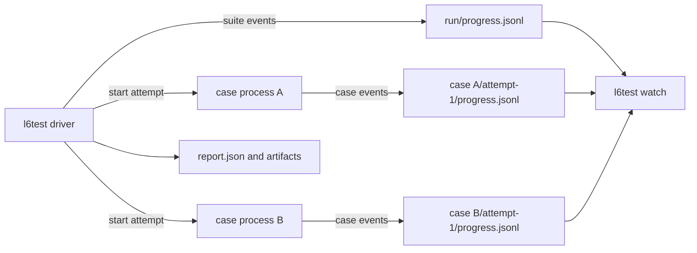
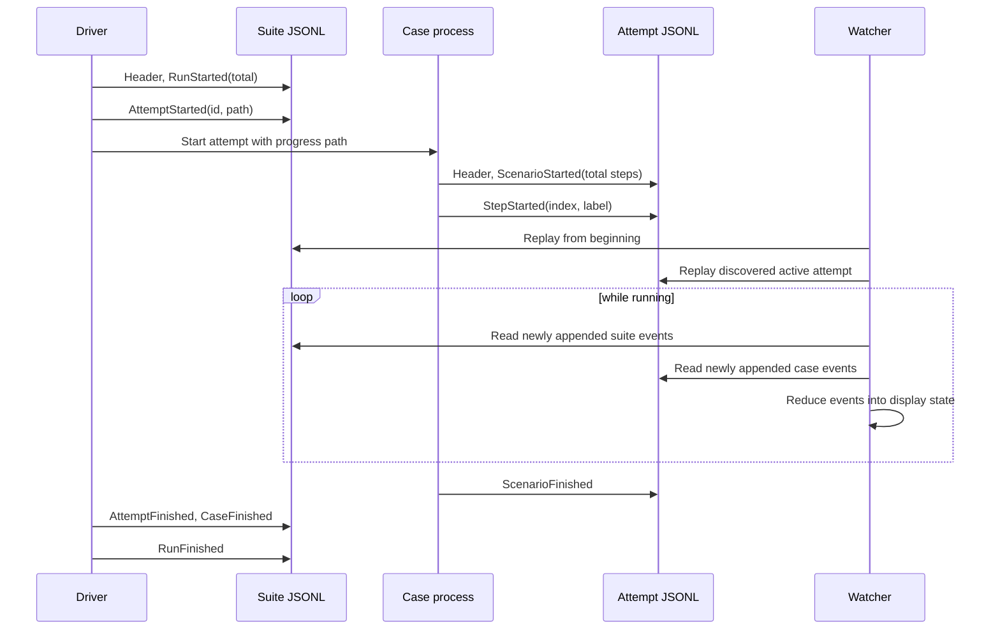
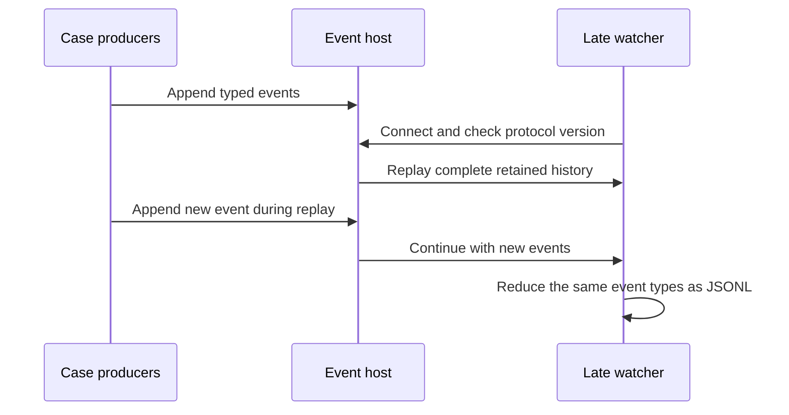

# Live test progress design

Status: JSONL event streams and the watcher are implemented; the socket
transport is a future option.

`l6test` runs long, potentially concurrent emulator scenarios. A watcher
should be able to attach after a run has started and show every active case,
its phase and, when available, its current scenario step and total. It should
also work after the run has ended. Viewing progress must not affect scheduling,
timeouts, test results or the child processes.

## Architecture

Each writer owns an append-only JSON Lines stream. The driver describes the
suite and its case attempts; an individual case process describes its own
progress. Each case attempt has a distinct file, so writers never append to the
same file. The driver does not interpret scenario steps.



The driver already controls case scheduling, fixture creation and retries. It
publishes `RunStarted`, attempt lifecycle and final case outcomes. The scenario
process publishes its effective step count and step transitions. For work
performed in the driver, such as fixture preparation, the driver can publish a
suite-stream phase event; only the child writes its per-attempt stream. Cases
without a scenario process, including packaged-app checks, can expose driver
phases without promising step detail.

`report.json`, attempt records, input identities and case artifacts remain the
source of truth for test results. Progress is an advisory view of activity,
not proof that a test ran, passed or was physically qualified. A completed
case's driver outcome takes precedence over any incomplete child stream.

## Typed protocol

Define shared Rust types in a dependency that both the driver and the scenario
runners can use without introducing a circular dependency. Derive
`serde::Serialize` and `serde::Deserialize` on structs and tagged enums. The
following is illustrative, not a promise of exact field names or crate layout:

```rust
struct StreamHeader {
    version: u32,
    run_id: RunId,
    stream: StreamId,
}

struct CaseId {
    case: String,
    model: Model,
    backend: Backend,
}

struct AttemptId {
    case: CaseId,
    attempt: u32, // one-based
}

enum SuiteEvent {
    RunStarted { total_cases: usize },
    AttemptStarted { id: AttemptId, progress_path: PathBuf },
    AttemptPhaseChanged { id: AttemptId, phase: Phase },
    AttemptFinished { id: AttemptId, outcome: AttemptOutcome },
    CaseFinished { id: CaseId, outcome: CaseOutcome },
    RunFinished { outcome: RunOutcome },
}

enum CaseEvent {
    PhaseChanged { phase: Phase },
    ScenarioStarted { total_steps: usize },
    StepStarted { index: usize, label: String }, // one-based
    ScenarioFinished { outcome: ScenarioOutcome },
}
```

Use a typed envelope for the header and subsequent events, with one serialized
value per newline and a tagged enum identifying the record. A header is the
first record of every stream; the first suite event is `RunStarted` and the
first scenario event is `ScenarioStarted`. An attempt stream exists only when
its case process supports progress. The driver can announce an attempt before
its file exists, because it knows the path it passed to the child.

The protocol version exists to detect a desynchronized watcher. The watcher
checks the header before interpreting events and **refuses to watch on a
version mismatch**, explaining the mismatch and which binary to use. There is
no compatibility negotiation, conversion or forward-compatibility promise.
A run ID and stream identity prevent a stale or unrelated attempt stream from
being accepted. A watcher uses the same run identity across all streams.

`CaseFinished` counts one case, regardless of its number of attempts. Attempt
failures followed by a successful retry must still produce the driver's final
`FLAKY` case outcome. Use the existing outcome definitions rather than
inventing a parallel meaning. A watcher must not derive a pass from an attempt
or infer a final result from a missing terminal event.

## Step semantics

A scenario publishes its step count only after includes are expanded and the
steps that do not apply to the model or selected setup state are removed. The
number displayed in `StepStarted` is the one-based position in that effective
sequence. If the runner retains a different internal index, it must map it to
this sequence without changing execution or error reporting. A zero-step
scenario is valid; do not display `1/0`.

Before scenario execution, display the known phase, such as fixture creation,
boot or readiness. A driver phase should be emitted only when that stage is
actually known. Some actions, such as the full knob-dialog check, encompass
many operations; they remain one step unless they explicitly publish more
detail later. Labels are short, display-oriented descriptions, not debug-formatted
structs. Step events describe start of work, not proof of completion.

## Files and watcher replay



The watcher reads the suite stream from the beginning, tracks each stream's
byte offset, and follows discovered active attempt streams. It can rebuild the
same view on late attach, including total cases and the current step. When
replaying after completion, suite `CaseFinished` events provide outcomes even
if the watcher never opens a case file. When an attempt completes, the
watcher can stop polling that attempt's stream. Counts come from final case
outcomes, not the number of attempt completions.

Records are appended as complete newline-terminated JSON values. A reader
buffers a trailing partial line and parses it only after the newline arrives;
EOF during an active run means wait for more data. The writer handles short
writes and serializes access to the driver stream across scheduler threads.
Each event is flushed promptly for visibility; an expensive durable `fsync`
per step is not required. A watcher must never depend on there being an event
per timer tick, and should bound display refresh separately from file polling.

A not-yet-created case stream is a normal startup condition. If a stream is
unreadable, ends unexpectedly, has an incomplete final record, or is malformed,
the watcher displays progress as unavailable or incomplete and can still
show the driver result and inspect `report.json`. It must not silently accept
a version mismatch. A crash or forced termination may leave no `RunFinished`;
EOF alone is not completion. The watcher should consult the run's actual
liveness mechanism and final report where available, and report uncertainty
rather than show a stale active case as definitively running.

Event writing and watching are observational. Failure to publish progress
should be visible as a diagnostic but must not turn a successful guest test
into a failure, deadlock a child, or make a watcher responsible for cleanup.
The authoritative report and existing supervision remain independent.

## Socket evolution

The file design is the initial transport. A later socket transport can carry
the **same typed event records and version**, without making the watcher depend
on a different state model. A server would own or relay the event history from
all streams and assign a sequence position per stream. It may retain that
history in memory for the life of the run, with a memory limit and overflow
policy chosen after measuring real suite event volume. The driver need only
route case records; it need not interpret their step payloads.



Replay and subscription must share an atomic boundary: events arriving during
replay are delivered once afterward, with no gap, duplication or reordering
within a stream. A reconnect starts a fresh full replay, or uses explicit
per-stream cursors if a later protocol defines them. This proposal does not
require a total order between independent case streams; suite case/attempt
lifecycle determines which stream is active. A slow watcher must not block
producers or tests: use a bounded client queue and disconnect it on overflow;
the watcher can reconnect and replay. Retention limits must never silently
present a partial history as complete. Socket availability after driver exit,
retention across process restarts, authentication and a combined multi-stream
framing format remain decisions for that transport, not guarantees of JSONL.

## Implementation and validation

1. Define and test shared Rust protocol types, version checks and stream
   identity. Specify the serialized representation with round-trip examples.
2. Add the driver suite stream and per-attempt paths; preserve existing report,
   retry and fixture identity behavior. Handle preflight, fixture failures and
   cases with no child progress.
3. Emit case events from the shared scenario runner after resolving effective
   steps. Both headless and GUI adapters use the same event source.
4. Use a streaming reducer for suite and active case files. Render progress
   without affecting non-terminal reporting.
5. Test late attach, concurrent cases, skipped/model-scoped steps, empty
   scenarios, retry-to-FLAKY, final outcomes with missing case streams, partial
   writes, mismatched versions, malformed input, interrupted producers and
   watcher disconnects. Run a focused real scenario on each adapter and verify
   the displayed sequence against its case artifacts, then run the relevant
   `l6test` checks. Measure full-suite event volume and overhead before
   deciding whether a socket's in-memory retention needs a limit.

The socket transport is a separate follow-up after the file protocol and its
consumers are validated.
