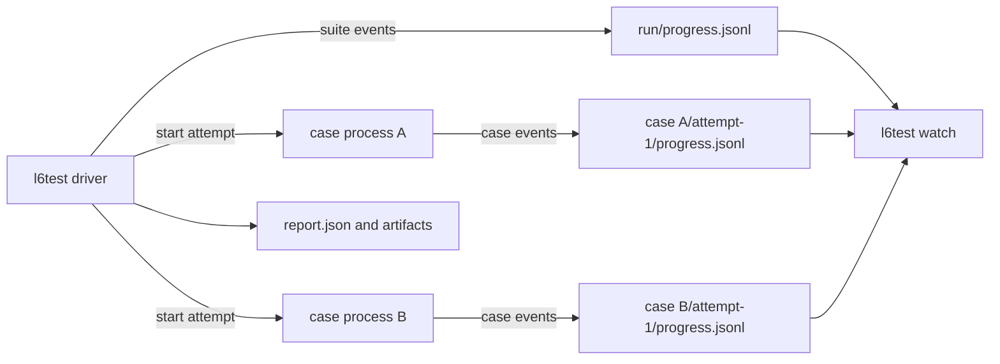
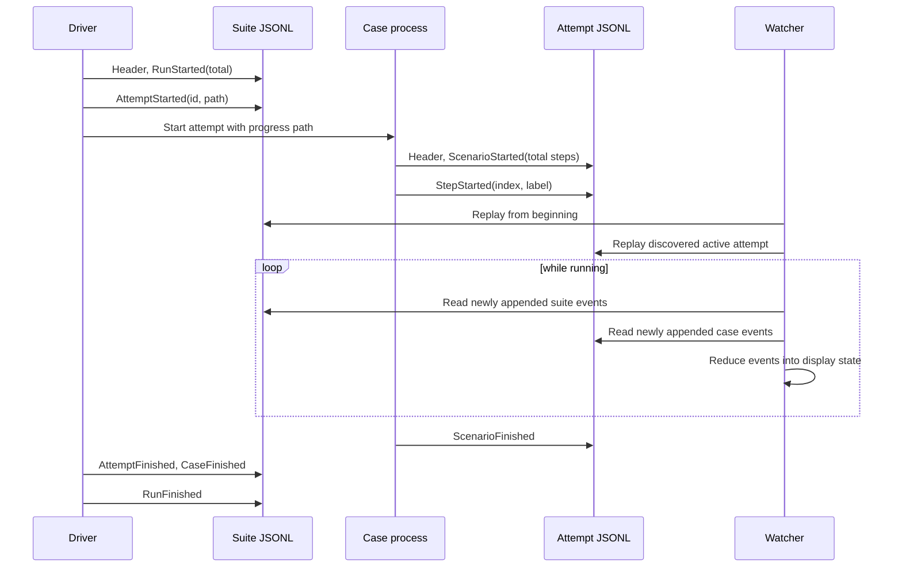
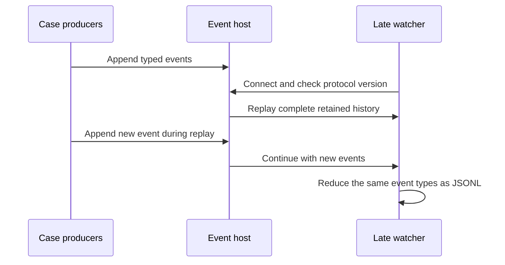

# Live test progress protocol and watcher

Status: implemented and merged in PR #108 with the later timing and watcher
updates. The live source of truth is `tools/smoke-core/src/progress.rs` for the
typed, versioned event protocol and `tools/l6test/src/progress.rs` for the
suite writer, replay reducer and watcher. The watcher tails append-only JSONL
streams, supports late attachment, and keeps file I/O/deserialization off the
terminal render loop. There is no compatibility adapter for the former
snapshot format: a missing stream or version mismatch is reported to the user.

`l6test` runs long, concurrent emulator scenarios. The watcher displays suite
and attempt phases, active scenario step and count, wall duration, retry state,
deferred failures and final case outcomes. Viewing progress does not affect
scheduling, timeouts, test results or child processes. `report.json` remains
authoritative.

## Architecture

Each writer owns an append-only JSON Lines stream. The driver writes the run
stream at `RUN_DIRECTORY/progress.jsonl`; each case attempt writes a distinct
`progress.jsonl` in its artifact directory. The driver publishes suite and
attempt lifecycle events but does not interpret scenario steps.

The driver controls scheduling, fixture creation and retries. It publishes
`RunStarted`, run phases, attempt lifecycle and final case outcomes. The case
process publishes case phases, its effective step count, step starts, adaptive
progress and failures. Driver phases cover setup work such as staging and
building; case phases cover emulator start and scenario preparation. A case
without a scenario process can report phases and final outcomes without step
detail.

`report.json`, attempt records, input identities and case artifacts remain the
source of truth for test results. Progress is an advisory view of activity,
not proof that a test ran, passed or was physically qualified. A completed
case's driver outcome takes precedence over any incomplete child stream.

## Typed protocol

`smoke_core::progress` defines the shared `CaseId`, `AttemptId`, `Outcome`,
`SuiteEvent` and `CaseEvent` Rust types. The tagged enums derive serde
serialization/deserialization and `Writer` appends one complete JSON value per
newline. Both stream headers carry protocol version 10 and the run identity;
case headers also carry the attempt identity. The watcher checks these headers
before reducing events and refuses a missing or mismatched version. There is
no compatibility negotiation or translation for older snapshot files.

The suite stream includes `RunStarted`, `RunPhaseChanged`, `AttemptStarted`,
`CampaignMemberStarted`, attempt phase/completion, `CaseFinished` and
`RunFinished`. A case stream includes phases, `ScenarioStarted`, `StepStarted`,
`StepProgress`, adaptive scope/child events, `DeferredAssertionFailed` and
`ScenarioFinished`. `StepStarted` carries a one-based effective index, label
and `started_unix_ms`; the watcher uses the next step or scenario finish to
stop its live duration. There is no `StepFinished` event. The driver does not
interpret the step stream.

`CaseFinished` counts one case, regardless of its number of attempts. Attempt
failures followed by a successful retry produce the driver's final `FLAKY`
case outcome. A watcher never derives a pass from an attempt or infers a final
result from a missing terminal event.

## Step semantics

A scenario publishes its step count after includes are expanded and steps that
do not apply to the model or setup state are removed. `StepStarted.index` is
the one-based position in that effective sequence. A zero-step scenario is
valid and is not displayed as `1/0`.

Before scenario execution, display the known phase, such as fixture creation,
emulator startup or scenario preparation. Some actions encompass many
operations; they remain one step unless they explicitly publish adaptive
detail. Labels are short display descriptions. A step-start event reports work
beginning, not successful completion.

## Files and watcher replay

The watcher reads the suite stream from the beginning, tracks each stream's
byte offset, and follows discovered active attempt streams. It rebuilds the
same view on late attach, including total cases and the current step. When
replaying after completion, suite `CaseFinished` events provide outcomes even
if the watcher never opens a case file. Attempt completion drains its event
stream before the reducer removes it. Counts come from final case outcomes,
not the number of attempt completions.

Records are appended as complete newline-terminated JSON values. The reader
keeps a byte offset, buffers a partial trailing line, and parses it only after
the newline arrives. Filesystem notifications wake a background reader thread;
a one-second check catches missed events or unsupported notifications. The
terminal thread receives reduced snapshots independently and redraws on its
own cadence. There is no event per timer tick.

A not-yet-created case stream is a normal startup condition. An unterminated
trailing line is buffered until more bytes arrive. A malformed or unreadable
stream stops the watcher with an explicit diagnostic; `report.json` remains
separate and available for inspection. The watcher refuses version mismatches.
A crash or forced termination may leave no `RunFinished`; EOF alone is not
completion. If a final report appears without a terminal event, the watcher
shows the report outcome as incomplete rather than treating it as a normal
completed stream.

Event writing and watching are observational. Failure to publish progress
should be visible as a diagnostic but must not turn a successful guest test
into a failure, deadlock a child, or make a watcher responsible for cleanup.
The authoritative report and existing supervision remain independent.

## Socket evolution

The file design is the initial transport. A later socket transport can carry
the **same typed event records and version**, without making the watcher depend
on a different state model. A server would own or relay the event history from
all streams and assign a sequence position per stream. It may retain that
history in memory for the life of the run, with a memory limit and overflow
policy chosen after measuring real suite event volume. The driver need only
route case records; it need not interpret their step payloads.

Replay and subscription must share an atomic boundary: events arriving during
replay are delivered once afterward, with no gap, duplication or reordering
within a stream. A reconnect starts a fresh full replay, or uses explicit
per-stream cursors if a later protocol defines them. This proposal does not
require a total order between independent case streams; suite case/attempt
lifecycle determines which stream is active. A slow watcher must not block
producers or tests: use a bounded client queue and disconnect it on overflow;
the watcher can reconnect and replay. Retention limits must never silently
present a partial history as complete. Socket availability after driver exit,
retention across process restarts, authentication and a combined multi-stream
framing format remain decisions for that transport, not guarantees of JSONL.

## Implementation and validation

The file protocol, typed writer/reducer, late replay, version refusal, retry
outcomes, deferred assertion display, adaptive-child progress, and independent
reader/render loops are implemented. Unit coverage exercises late attachment,
concurrent case streams, retries, failures during collection, partial lines,
version mismatch and final-report recovery. Headless and GUI scenarios share
the same case-event source. The `docs/development/testing.md` report section
documents the command, event timing and report authority.

The optional socket transport remains future work. It can carry the same typed
events, but needs its own bounded replay/subscription protocol and memory
policy; the JSONL implementation does not depend on it.
